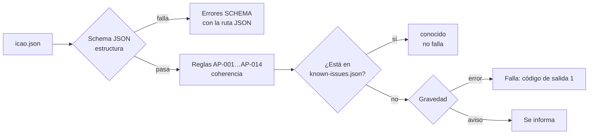

# Validador de aeropuertos

Comprueba cada archivo `assets/airports/<icao>.json` antes de que llegue al simulador. Se ejecuta en
local y en cada pull request (trabajo **Validar aeropuertos** de `ci.yml`); un error bloquea el PR.

```sh
npm run validate:airports                 # todos los aeropuertos activos
node tools/validate/validate-airports.js lemd lemg   # solo algunos
node tools/validate/validate-airports.js --all       # también los desactivados
node tools/validate/validate-airports.js --json      # informe para otras herramientas
node tools/validate/validate-airports.js --quiet     # solo errores
```



## Dos niveles

1. **Schema** (`assets/airports/schema/airport.schema.json`, JSON Schema draft 2019-09): estructura y
   tipos tal como los lee el motor. Rechaza propiedades que el motor no lee (por ejemplo una errata como
   `lenght`), coordenadas mal escritas, líneas de mapa incompletas o aerolíneas sin peso. Si el schema
   falla, las reglas no se ejecutan.
2. **Reglas** (`tools/validate/rules.js`): coherencia entre partes del archivo y con el resto de assets.

## Reglas

| ID | Gravedad | Qué comprueba |
|---|---|---|
| AP-001 | error | El nombre del archivo coincide con el ICAO y el aeropuerto está en `airportLoadList.json` |
| AP-002 | error | Pares de pistas recíprocos (18 de diferencia, L↔R, C↔C) y umbrales en sitios distintos |
| AP-003 | error | Todo fijo usado en SID, STAR y aerovías existe en `fixes` |
| AP-004 | error | Las pistas citadas (por defecto, configuraciones, rodaje, procedimientos) existen |
| AP-005 | error | Cada nombre de una ruta de aparición es un fijo, un procedimiento, una aerovía o un aeropuerto (con pista opcional) |
| AP-006 | error | Las aerolíneas y flotas de los spawn patterns existen, con las mayúsculas exactas |
| AP-007 | error / aviso | Suelo de cada sector por debajo del techo (si son iguales: aviso, sector de grosor cero) |
| AP-008 | aviso | Los polígonos de espacio aéreo y zonas restringidas no se cruzan consigo mismos |
| AP-009 | error | Los mapas de `defaultMaps` existen |
| AP-010 | error | Existe `terrain/<icao>.geojson` cuando `has_terrain` es `true` |
| AP-011 | aviso | Los aeropuertos españoles (`LE**`) hacen entrar las llegadas escalonadas (`arrivalSpawn`) |
| AP-012 | aviso | El `icao` de cada SID y STAR coincide con su clave |
| AP-013 | aviso | El rumbo entre umbrales coincide con el nombre de la pista (±15°, corregido por la declinación) |
| AP-014 | aviso | Las configuraciones de pista citadas en los spawn patterns existen |

Las coordenadas se interpretan con `parseCoordinate` del propio motor, así que el validador lee los datos
igual que el juego.

## Problemas conocidos

`tools/validate/known-issues.json` recoge defectos reales que no se pueden corregir sin datos fiables (por
ejemplo, un fijo sin coordenadas publicadas a mano). Aparecen como `conocido` y no hacen fallar la
validación. Cada entrada lleva el motivo; se borra en cuanto se corrige el dato.

## Añadir una regla

1. Añade un objeto a `RULES` en `tools/validate/rules.js` con `id` (el siguiente `AP-xxx` libre),
   `severity`, `description` en español y `check(airport, context)`, que devuelve `[{ path, message }]`.
   Un problema puede llevar su propia `severity` si la gravedad depende del caso.
2. Añade un test en `test/tools/validateAirports.spec.js` que rompa LEMD a propósito y espere la regla.
3. Ejecuta `npm run validate:airports`. Si la regla nueva da errores en aeropuertos existentes, corrige
   el dato o, si no hay datos fiables, regístralo en `known-issues.json` con su motivo.
4. Añade la fila a la tabla de esta página.

## Estado (2026-11-20)

- 66 aeropuertos activos: 0 errores, 10 con avisos.
- Corregidos al crear el validador:
  - **RJAA:** coordenada del fijo `_NRE045021` (`E140d40d06.00` → `E140d40m06.00`).
  - **LTBA:** 16 coordenadas del mapa con grados y minutos invertidos.
  - **EGNM:** una polilínea del mapa escrita como 121 puntos sueltos, convertida en 120 segmentos.
  - **KIAD:** la aerolínea `n/fastGA` no tenía peso y nunca aparecía; ahora tiene peso 1.
  - **EDDF:** fijo `tau` en minúsculas en la STAR KERA4M (`TAU`).
- 38 de los 40 aeropuertos desactivados usan el formato antiguo de mapas (sin `defaultMaps`, `maps` como
  objeto) y no pasan el schema.
