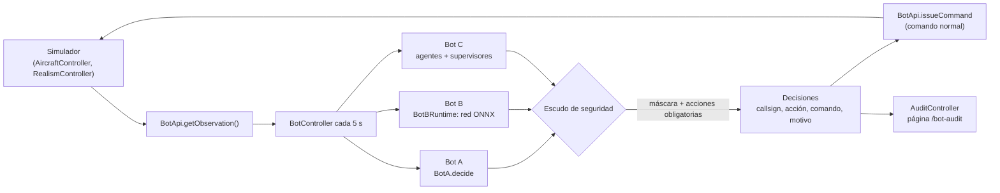
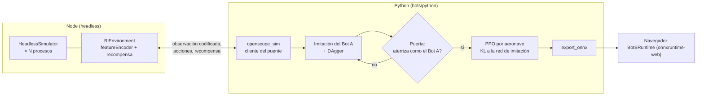

# Arquitectura de los bots

## De la observación a la orden

Cada 5 segundos de juego, `BotController` pide a `BotApi` una **observación** (aeropuerto, reglas del perfil
normativo y, por aeronave, posición, altitud, velocidad, fase, ruta, autorizaciones, altitud mínima por delante,
emergencia…) y se la pasa al bot activo. El bot devuelve decisiones `{ callsign, action, command, reason }`.
Cada decisión se envía como un **comando normal** por `BotApi.issueCommand` (la misma
[cadena](../motor/comandos.md) que usa el jugador) y queda registrada en la auditoría.

## Escudo de seguridad

`bot/safetyShield.js` se aplica a los tres bots:

- **Máscara de acciones** (`getActionMask`): parte de la [disponibilidad](matriz-comandos.md#disponibilidad-máscara-de-acciones)
  de cada acción y además prohíbe las que llevarían a la aeronave por encima del techo del espacio aéreo o fuera
  de él, por debajo de la altitud mínima o contra un suelo más alto por delante. Durante un RA del TCAS no permite
  órdenes de altitud ni de procedimiento a esa aeronave ([redes de seguridad](../motor/stca-tcas.md)).
- **Acciones obligatorias** (`getRequiredActions`): si un seguidor en final está más cerca del mínimo que su
  líder, frustrada a menos de 6 NM del umbral o viraje de separación más lejos; si viene un suelo de espacio aéreo
  más alto, ascenso.

El Bot A y el Bot C atienden primero las acciones obligatorias; al Bot B el escudo le corrige la acción que
elija la red.

## Bot A

Un planificador experto (`bot/botA/`): secuenciación de llegadas y salidas, detección y resolución de
conflictos con predicción a 2 minutos, unión al ILS según el terreno y vectores. Ver
[razonamiento](razonamiento.md) y [Bot A](bot-a.md).

## Bot C

Comparte el planificador del Bot A, pero reparte las aeronaves entre **agentes** con dueño y competencias
(`bot/botC/agents.js`): la Torre es dueña de todo lo que está en tierra o por debajo de 3000 ft sobre el
aeropuerto; Entradas, ILS y Salidas del resto según su fase. Cada agente solo puede dar las acciones de su
competencia ([matriz](matriz-comandos.md#competencias-de-los-agentes-del-bot-c)). Un **supervisor** por agente
y uno global juzgan cada orden (sin intervenir) y registran por qué es buena, dudosa o mala. Ver [Bot C](bot-c.md).

## Bot B: entrenamiento

La red recibe la observación codificada (`bot/rl/featureEncoder.js`, versión de features 7: una fila por
aeronave con su historial de órdenes y la secuencia de aterrizaje, más datos globales). Primero imita al Bot A;
solo si aterriza al menos el 80 % que él pasa a PPO. Cualquier cambio en la observación o en las acciones obliga
a reentrenar. Ver [Bot B](bot-b.md) y [entrenamiento](entrenamiento.md).
