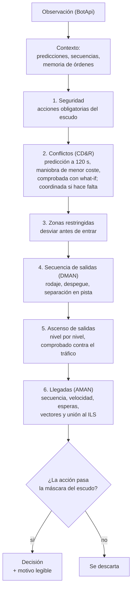

# Modelo de razonamiento

Cómo decide cada bot en un ciclo (cada 5 segundos de juego).

## Bot A: un ciclo

`BotA.decide(observation)` construye un **contexto** (aeronaves por indicativo, secuencias de aterrizaje,
predicciones) y recorre las tareas en un orden fijo. **Cada aeronave recibe como máximo una orden por ciclo**: la
primera tarea que le da una orden válida gana, y las siguientes ya no la tocan. Por eso el orden de las tareas
es su prioridad.

### Qué comprueba antes de dar una orden

- **Máscara del escudo:** si la acción no está permitida para esa aeronave en ese momento, no se da.
- **Altitudes comprobadas** (`addChecked`): un ascenso o descenso de los planes se para antes si chocaría con
  tráfico; el motivo lo indica («stopped short for traffic»).
- **What-if** en la resolución de conflictos: la maniobra se simula y solo se da si separa a la pareja sin crear
  un conflicto con un tercero. Si mover a una no basta, se coordinan las dos con órdenes complementarias.
- **Memoria:** recuerda cuándo dio cada orden a cada aeronave (para no repetir y para mantener una resolución
  hasta que reanudar no recree el conflicto).

### Predicción

La resolución de conflictos predice cada trayectoria como la vuela el simulador: los ascensos a la altitud
autorizada en modo HOLD (directos al nivel) y los descensos por el procedimiento en VNAV (respetando
restricciones y el punto de inicio de descenso). Los pasos son de 2 s los primeros 10 s y de 10 s después. El
detalle está en [Bot A: qué hace en cada ciclo](bot-a.md#qué-hace-en-cada-ciclo).

## Bot C: agentes

El Bot C usa el mismo planificador y el mismo orden, pero cada aeronave tiene un **dueño** (Torre por debajo de
3000 ft AGL o en tierra; Entradas en ruta; ILS en vectores y final; Salidas en ascenso) y cada agente solo puede
dar las acciones de su competencia. Además:

- la Torre puede alinear (`lineup`) a la siguiente en salir y **cancelar un despegue** (`abort`) cuando hay una
  llegada demasiado cerca o una emergencia;
- un **supervisor** por agente y uno global evalúan cada orden con una predicción independiente y registran la
  causa de cada incidente, sin intervenir.

## Bot B: red neuronal

El Bot B no sigue reglas: una red con atención puntúa las 66 acciones para cada aeronave a partir de la
observación codificada (incluido el historial de órdenes, para saber si acaba de girar a una aeronave). Se
elige la acción permitida de mayor puntuación, con un sesgo calibrado hacia «no hacer nada» para no hablar más
que el Bot A. El escudo corrige lo que la red elija si una acción obligatoria lo exige.
