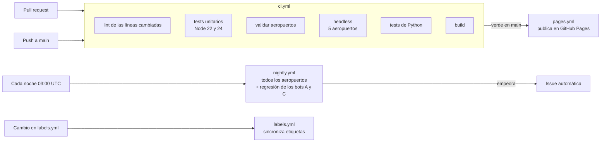

# Integración y despliegue continuos (GitHub Actions)

Los workflows viven en `.github/workflows/`.



| Workflow | Cuándo | Qué hace |
|---|---|---|
| `ci.yml` | Cada pull request, cada push a `main`, o a mano | ESLint sobre las líneas cambiadas, tests unitarios con cobertura (Node 22 y 24), validación de aeropuertos (schema + reglas), simulador headless en 5 aeropuertos, tests de Python y build |
| `pages.yml` | Cuando `ci.yml` termina bien en un push a `main`, o a mano | Construye el simulador y lo publica en <https://jossseluuu.github.io/openScope/> |
| `nightly.yml` | Cada noche a las 03:00 UTC, o a mano | Vuela todos los aeropuertos activos y ejecuta la regresión completa de los bots A y C. Si un bot empeora, abre una issue (una sola mientras siga abierta) |
| `labels.yml` | Cuando cambia `.github/labels.yml` | Crea o actualiza las etiquetas del repositorio (no borra las que no están en el archivo) |

`.github/dependabot.yml` propone actualizaciones semanales de las GitHub Actions. Para npm solo
avisa de vulnerabilidades: las dependencias del motor son antiguas y se actualizan a mano.

## Detalles

- **Lint:** solo se revisan las líneas cambiadas (`lint-diff`), porque el código heredado tiene errores
  antiguos. En un PR se compara con la rama base; en un push, con el commit anterior.
- **Saltos de línea:** el repositorio guarda los archivos en LF. En Windows, Git puede convertirlos a
  CRLF en la copia de trabajo, y entonces ESLint en local da errores `linebreak-style` que en CI no
  aparecen. En local: `npx eslint --rule 'linebreak-style: off' <archivos>`.
- **Cobertura:** el informe (`coverage/`) se sube como artefacto del trabajo de Node 24 y se guarda 14 días.
- **Python en CI:** se instala PyTorch solo CPU; en local se usa la versión CUDA (ver
  `bots/python/requirements.txt`).
- **Concurrencia:** un push nuevo a la misma rama cancela la ejecución anterior de `ci.yml`.

## Protección de la rama main (configuración manual en GitHub)

En *Settings → Branches → Add branch ruleset* para `main`:

1. Exigir pull request antes de fusionar.
2. Exigir que pasen estas comprobaciones: `ESLint (líneas cambiadas)`, `Tests unitarios (Node 22)`,
   `Tests unitarios (Node 24)`, `Validar aeropuertos`, `Simulador headless (5 aeropuertos, 20 min)`, `Tests de Python (bots)` y
   `Build`.
3. Opcional: impedir los force push.

## Ejecutar lo mismo en local

```sh
npm run lint-diff -- HEAD~1..HEAD
npm test
npm run validate:airports
npm run test:headless
npm run test:py
npm run build
```

Ver también [Testing](testing.md).
