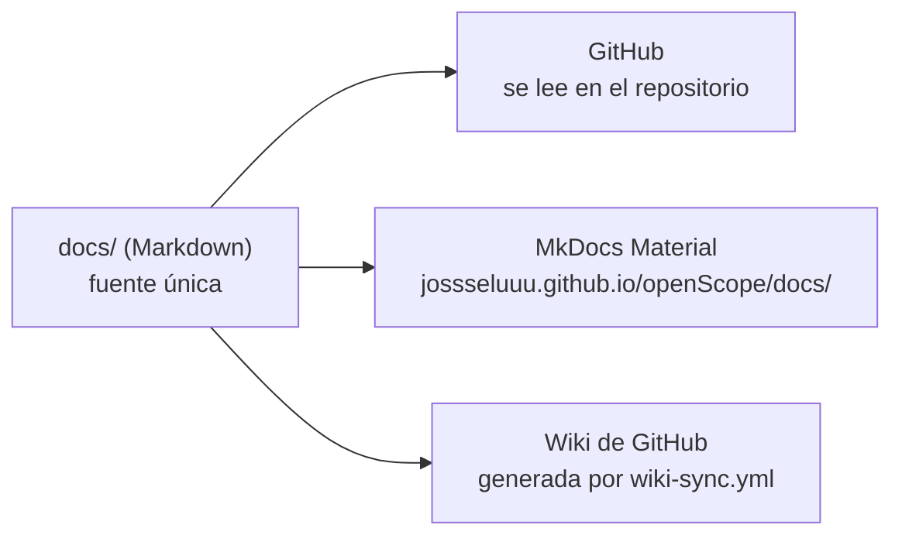

# Cómo documentar

La documentación es código: vive en `docs/`, se revisa en los pull requests y CI la comprueba.

## Dónde va cada cosa

| Carpeta | Contenido |
|---|---|
| `docs/guia-jugador/` | Cómo jugar: comandos, puntuación, emergencias, voz y copiloto |
| `docs/aeropuertos/` | Formato de aeropuerto, validador, guías por aeropuerto (`guias/`, que la build mete en la app) |
| `docs/motor/` | Arquitectura y funcionamiento interno del simulador |
| `docs/especificacion/` | Hoja de especificaciones: **se genera** desde `reglas.yaml` |
| `docs/bots/` | Bots A, B y C, razonamiento, matriz de comandos (**generada**), entrenamiento |
| `docs/desarrollo/` | Testing, CI/CD, procesos, flujo de git |
| `docs/adr/` | Registros de decisiones de arquitectura |

## Una sola fuente, tres sitios



- **La Wiki no se edita a mano.** `wiki-sync.yml` la regenera desde `docs/` en cada push a `main` que toque
  `docs/` o `mkdocs.yml`; cualquier cambio hecho en la Wiki se pierde.
- Las páginas generadas (`especificacion/*.md`, `bots/matriz-comandos.md`, `bots/parametros.md`) llevan un
  comentario al principio. Se cambian editando su fuente y ejecutando el generador.

## Previsualizar

```sh
python -m venv .venv-docs
.venv-docs/Scripts/python -m pip install -r docs/requirements.txt   # Windows
.venv-docs/Scripts/python -m mkdocs serve                             # http://127.0.0.1:8000
```

## Generadores

```sh
npm run docs:generate   # hoja de especificaciones, matriz de comandos y parámetros de los bots
npm run docs:check      # falla si alguna página generada no está al día (lo ejecuta CI)
```

## Estilo

- Español, frases cortas, términos aeronáuticos habituales (los nombres de comandos, archivos y clases, en su
  forma original).
- Una página por tema; enlaces relativos entre páginas (`../motor/bucle.md`).
- Diagramas en Mermaid (ver [diagramas](diagramas.md)).
- Si la página explica una regla con valor, enlaza su identificador de la
  [hoja de especificaciones](../especificacion/index.md) en lugar de repetir el número.
- Al terminar una funcionalidad: su página, su diagrama si cambia la arquitectura y la entrada en
  `CHANGELOG.md`.
