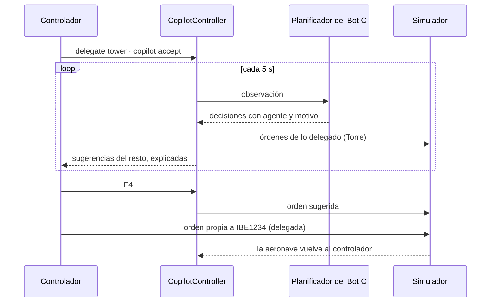

# Copiloto

Un asistente que trabaja contigo en vez de sustituirte: avisa, propone órdenes explicando por qué y, si quieres, se
encarga de aeronaves concretas o de sectores enteros. Por dentro usa el planificador del [Bot C](../bots/bot-c.md):
cada aeronave tiene un agente responsable (Torre, Entradas, ILS, Salidas…) con sus competencias.

## Niveles

En las opciones, *Copilot*, o con el comando `copilot <nivel>`:

| Nivel | Comando | Qué hace | ¿Da órdenes? |
|---|---|---|---|
| Apagado | `copilot off` | Nada (salvo lo delegado) | Solo en lo delegado |
| Avisos | `copilot alerts` | Avisa de STCA, RA del TCAS, MSAW, APW y emergencias (una vez cada uno) | No |
| Sugerencias | `copilot suggest` | Propone órdenes explicadas: agente, urgencia y motivo. Tú las tecleas | No |
| Sugerencias aceptables | `copilot accept` | Lo mismo; **F4** acepta la primera sugerencia y **F6** la descarta | Al aceptar |

Una sugerencia caduca a los 30 segundos y desaparece si das tú una orden a esa aeronave.

## Delegación

Funciona con cualquier nivel:

| Comando | Qué delega |
|---|---|
| `delegate IBE1234` (`delegar`) | Esa aeronave |
| `delegate tower` / `torre` | Todo lo que está en tierra o a menos de 3000 ft sobre el aeropuerto |
| `delegate departures` / `salidas` | Las salidas por encima de 3000 ft |
| `delegate arrivals` / `llegadas` | Las llegadas en ruta |
| `delegate final` / `ils` | Las llegadas en vectores y final |
| `delegate approach` / `aproximacion` | Llegadas, final, coordinación y separación |
| `delegate all` / `todo` | Todo: equivale a `bot c` |
| `recover <lo mismo>` (`recuperar`) | Lo recupera; `recover all` lo recupera todo |

Si das una orden a una aeronave que delegaste por indicativo, vuelve a ser tuya. Un sector delegado sigue delegado
hasta que lo recuperes.

## Reglas

- El copiloto **no actúa mientras un bot lleva el aeropuerto** (`bot a`, `bot b`, `bot c`).
- Todas sus órdenes pasan por el escudo de seguridad y quedan en la auditoría con origen `copilot`.
- Nunca sugiere ni da órdenes de altitud a una aeronave en RA del TCAS.
- Ver la escala completa en [niveles de automatización](../bots/automatizacion.md).
