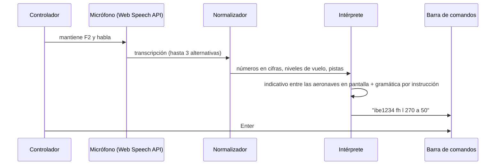

# Voz y lenguaje natural

Puedes dar instrucciones hablando o escribiendo frases de fraseología ATC normales, en inglés o en español. El
simulador las traduce a su comando y **las escribe en la barra de comandos para que las confirmes con Enter**:
nunca envía nada sin tu confirmación.

## Voz

1. En las opciones, *Voice commands (hold F2)*: **English** o **Español**.
2. Mantén pulsada **F2**, di la instrucción y suelta.
3. Comprueba el comando propuesto en la barra y pulsa **Enter**.

Necesita Chrome o Edge (Web Speech API). En Chrome el audio lo procesa el servicio de voz de Google.

## Lenguaje natural escrito

Escribe la frase tal cual en la barra de comandos («iberia 1234 vire a la izquierda rumbo 270 y descienda a 5000»).
Si no es un comando válido del simulador, se interpreta y se propone el comando: «did you mean: IBE1234 fh l 270 a 50?».
Pulsa Enter para enviarlo.

## Indicativo

Se busca solo entre las aeronaves en pantalla, por código ICAO («IBE1234», «ibe 1234») o por el indicativo
radiofónico de la aerolínea («Iberia uno dos tres cuatro», «Ryanair…», «Speedbird…»). Se tolera un pequeño error en el
nombre de la aerolínea, **nunca en el número de vuelo**: si el número no coincide con ninguna aeronave, no se propone
nada.

## Frases admitidas

Los números pueden decirse dígito a dígito («dos siete cero», «tree four zero», «niner») o como cantidad («cinco mil»,
«three thousand five hundred», «tres mil quinientos»). Varias instrucciones en una misma frase se proponen en el orden
en que se dijeron.

| Instrucción | Inglés | Español | Comando |
|---|---|---|---|
| Rumbo | turn left/right heading 270 · fly heading 270 | vire/gire a la izquierda/derecha rumbo 270 · rumbo 270 | `fh l 270` |
| Altitud | climb/descend (and maintain) 5000 · flight level 120 · maintain 3500 | ascienda/descienda (y mantenga) 5000 · suba/baje a nivel de vuelo 120 | `a 50`, `a 120` |
| Expedito | … expedite | … expedito | `a 40 ex` |
| Velocidad | reduce/increase speed (to) 180 (knots) | reduzca/aumente velocidad 180 (nudos) | `sp 180` |
| Directo | proceed direct (to) NANDO · direct to NANDO | proceda directo a NANDO · directo a NANDO | `pd NANDO` |
| Espera | hold at RESBI | mantenga en espera sobre RESBI · espere sobre RESBI | `hold RESBI` |
| ILS | cleared ILS (approach) runway 32 left | autorizado (aproximación) ILS pista tres dos izquierda | `i 32L` |
| Aterrizaje | cleared to land (runway 32L) | autorizado a aterrizar (pista 32L) | `land` |
| Frustrada | go around | motor y al aire · frustre | `ga` |
| Rodaje | taxi (to) runway 36L | ruede (a la) pista 36L | `taxi 36L` |
| Alinear | line up and wait | alinee y espere | `lineup` |
| Despegue | cleared for takeoff | autorizado a despegar | `cto` |
| Cancelar despegue | stop immediately · cancel takeoff clearance | pare inmediatamente · cancelo autorización de despegue | `abort` |
| Procedimiento | climb via SID · descend via STAR | ascienda según la SID · descienda según la STAR | `cvs`, `dvs` |
| Transpondedor | squawk 4521 | transponda 4521 | `sq 4521` |

Los fijos se reconocen con un error de una letra como mucho, y solo si no hay ambigüedad con otro fijo del aeropuerto.

## Para desarrolladores

- `src/assets/scripts/client/voice/phraseologyNormalizer.js`: limpieza y números.
- `src/assets/scripts/client/voice/commandInterpreter.js`: indicativo y gramática (`INSTRUCTIONS`).
- `src/assets/scripts/client/voice/SpeechRecognitionController.js`: Web Speech API y F2.
- Corpus de pruebas: `test/voice/commandInterpreter.spec.js` (35 frases en inglés y 30 en español, todas correctas).
