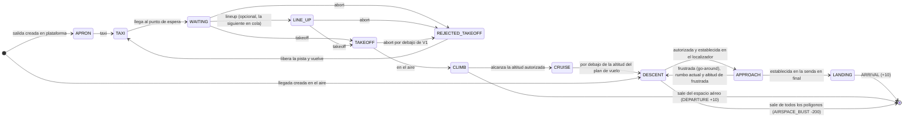

# Aeronaves: ciclo de vida y fases de vuelo

Cada aeronave es un `AircraftModel` (`aircraft/AircraftModel.js`). Su categoría (`arrival`, `departure` u
`overflight`) viene del spawn pattern que la creó. Las fases están en `FLIGHT_PHASE`
(`constants/aircraftConstants.js`) y las cambia `updateFlightPhase()`.

## Notas

- **Emergencia (squawk 7700):** no es una fase. Es un estado de las llegadas (`EmergencyController`): se
  dibuja en rojo, tiene un plazo para aterrizar, rechaza esperas y desciende de forma expedita (reglas
  [EMG-001 a EMG-004](../especificacion/operaciones.md)).
- **Cancelación de despegue:** `abort` en el punto de espera, alineada o durante la carrera por debajo de V1
  (0,9 × velocidad mínima). La aeronave frena en la pista (`REJECTED_TAKEOFF`), rueda de vuelta y queda oculta
  hasta estar lista otra vez ([DEP-002 a DEP-004](../especificacion/operaciones.md)).
- **Frustrada:** por aproximación no estabilizada, pista ocupada a 200 ft o por orden. La aeronave pierde la
  autorización de aproximación, mantiene el rumbo, sube a la altitud de frustrada y vuelve a la fase `DESCENT`.
- **Esperas:** las gestiona el FMS dentro de la fase en curso. `FLIGHT_PHASE.HOLD` existe en la lista pero
  ningún código la activa (auditoría 2026-11-20).
- **Controlabilidad:** una aeronave que sale de todos los polígonos de espacio aéreo (lateralmente o por
  debajo del suelo) deja de ser controlable y se elimina.
- **Aparición:** toda aeronave en el aire pasa `RealismController.checkSpawn` (margen de separación y por
  encima del suelo y de la MVA) antes de aparecer.
