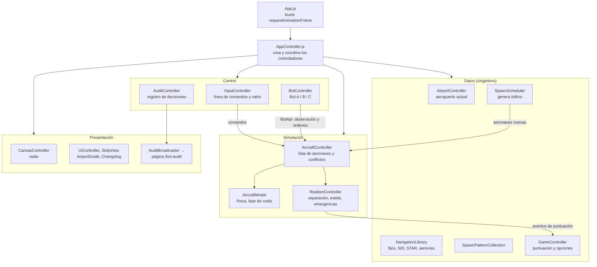

# Arquitectura del motor

El simulador es una aplicación de navegador (JavaScript ES2015+ compilado con Babel y Browserify) que también
puede ejecutarse sin interfaz en Node (*headless*) para los bots y los tests. El código está en
`src/assets/scripts/client/`; los datos (aeropuertos, aeronaves, aerolíneas) en `assets/`.

## Piezas principales

| Pieza | Archivo | Responsabilidad |
|---|---|---|
| `App` | `App.js` | Carga los datos, crea `AppController` y lanza el bucle de cada fotograma |
| `AppController` | `AppController.js` | Crea los controladores y decide el orden de actualización; cambia de aeropuerto |
| `AirportController` | `airport/AirportController.js` | Aeropuerto actual: pistas, espacio aéreo, viento, terreno |
| `NavigationLibrary` | `navigationLibrary/NavigationLibrary.js` | Fijos, procedimientos (SID/STAR) y aerovías del aeropuerto |
| `SpawnScheduler` | `trafficGenerator/SpawnScheduler.js` | Crea aeronaves según los spawn patterns (y `arrivalSpawn`) |
| `AircraftController` | `aircraft/AircraftController.js` | Lista de aeronaves, conflictos entre parejas y realismo |
| `AircraftModel` | `aircraft/AircraftModel.js` | Una aeronave: fase de vuelo, objetivos, física, controlabilidad |
| `RealismController` | `realism/RealismController.js` | Reglas operacionales: separación, estela, pista, emergencias, torre automática |
| `GameController` | `game/GameController.js` | Puntuación (`GAME_EVENTS_POINT_VALUES`), opciones del juego |
| `InputController` | `InputController.js` | Comandos del jugador y ratón |
| `BotController` | `bot/BotController.js` | Ejecuta el bot activo y envía sus órdenes como comandos normales |
| `AuditController` | `audit/AuditController.js` | Registra órdenes, puntuación y pasos para entrenar al Bot B |
| `CanvasController` | `canvas/CanvasController.js` | Dibuja el radar |

## Headless

`src/assets/scripts/headless/` contiene `HeadlessSimulator` (el mismo motor sin dibujo) y `RlEnvironment`
(el entorno de aprendizaje por refuerzo). `tools/sim/bootstrap.js` prepara Node: instala un `Math.random`
con semilla (la partida es **determinista**: misma semilla, mismo resultado), compila con Babel al vuelo y
simula el DOM mínimo. Los bots en Python hablan con este simulador por un puente
(`bots/python/openscope_sim/`).

Ver también: [bucle de simulación](bucle.md), [aeronaves](aeronaves.md),
[cadena de un comando](comandos.md), [arquitectura de los bots](../bots/arquitectura.md).
