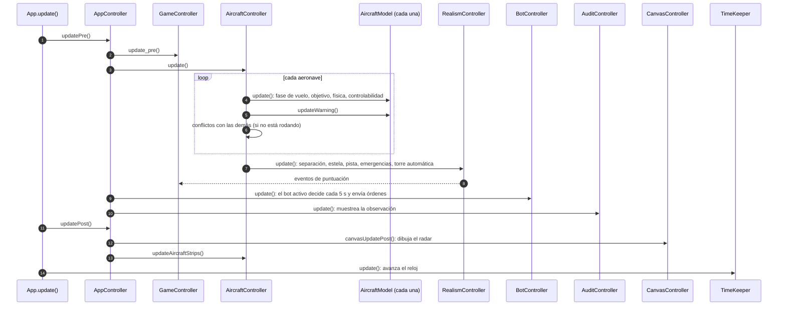

# Bucle de simulación

Cada fotograma (`requestAnimationFrame`) `App.update()` llama a `updatePre()`, `updatePost()` y
`TimeKeeper.update()`. El tiempo de juego avanza según `TimeKeeper` (con la aceleración *timewarp*), así que
la física usa el tiempo transcurrido, no el número de fotogramas.

## Física de una aeronave

`AircraftModel.update()` hace, en este orden:

1. `updateFlightPhase()`: pasa de fase cuando se cumplen las condiciones (ver [aeronaves](aeronaves.md)).
2. `updateTarget()`: rumbo, altitud y velocidad objetivo según el piloto automático (MCP) y el FMS.
3. `updatePhysics()`: gira, asciende o desciende y acelera hacia el objetivo con el rendimiento del tipo, y
   mueve la aeronave: velocidad verdadera a partir de la indicada, más el viento como vector
   (`updateGroundSpeedPhysics`, reglas [ATM-001 a ATM-003](../especificacion/unidades-atmosfera.md)).
4. Controlabilidad: fuera de todos los polígonos de espacio aéreo deja de ser controlable y se elimina
   ([ASP-001](../especificacion/espacio-aereo-terreno.md)).

## Detección de conflictos

Hay dos niveles:

- `AircraftConflict` (por pareja, en `AircraftController`): distancia actual, avisos y violaciones para la
  interfaz.
- `RealismController`: comprueba cada segundo de juego las reglas del perfil normativo (separación radar,
  aproximación final, estela, salida/llegada, paralelas) y genera los eventos de puntuación y del
  *rulebook*.

Por encima de ambos, las [redes de seguridad](stca-tcas.md) (STCA, TCAS, MSAW, APW) predicen y avisan.
