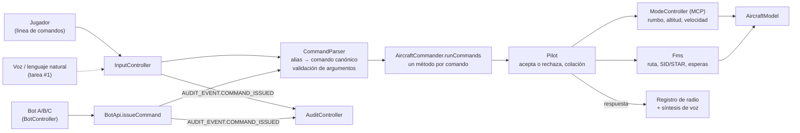

# Cadena de un comando

Un comando del jugador, de un bot o (en el futuro) de la voz recorre la misma cadena. Los bots no tienen atajos:
solo pueden dar las órdenes que daría un controlador humano.

| Paso | Archivo | Qué hace |
|---|---|---|
| Entrada | `InputController.js` | Lee la línea, identifica la aeronave por indicativo |
| Análisis | `commands/parsers/CommandParser.js` | Separa comandos y argumentos; convierte alias (`fh`, `dm`…) en el nombre canónico de `aircraftCommandMap.js`; valida |
| Ejecución | `aircraft/AircraftCommander.js` | Un método por comando (rumbo, altitud, ILS, despegue…) |
| Piloto | `aircraft/Pilot/Pilot.js` | Decide si puede cumplir (p. ej. no acepta una espera en emergencia) y genera la colación |
| Guiado | `aircraft/ModeControl/`, `aircraft/FlightManagementSystem/` | Modos del piloto automático y ruta |

Cada orden aceptada o rechazada se registra en la auditoría (`AUDIT_EVENT.COMMAND_ISSUED`) con su origen
(`player`, `bot A`…), lo que alimenta la página `/bot-audit` y los datos de entrenamiento del Bot B.

La referencia de comandos está en [comandos](../guia-jugador/comandos.md),
[comandos de aeronave](../guia-jugador/comandos-aeronave.md) y [comandos del radar](../guia-jugador/comandos-radar.md).
