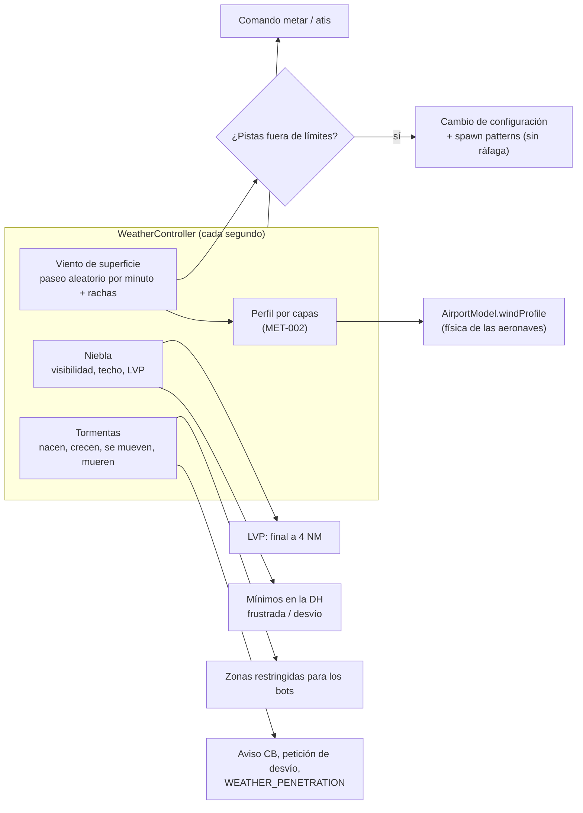

# Meteorología dinámica

El tiempo cambia durante la partida y afecta a las aeronaves, a las pistas en uso, a los mínimos de aterrizaje y a
las decisiones del controlador y de los bots. Vive en `src/assets/scripts/client/weather/`: la lógica pura en
`weatherLogic.js` (probada en `test/weather/weatherLogic.spec.js`) y su integración en `WeatherController.js`, que
el `RealismController` ejecuta cada segundo de juego. Reglas y valores: [MET-001 a MET-011](../especificacion/meteorologia.md).

| Modo | Dónde es el predeterminado | Qué hace |
|---|---|---|
| **Estática** | Headless (bots, regresión, entrenamiento) | El viento fijo del aeropuerto, creciendo un 2 % por cada 1000 ft (comportamiento original) |
| **Dinámica** | Navegador | Viento por capas que evoluciona, rachas, niebla con LVP, tormentas que se mueven, cambios de pista |

La meteorología dinámica tiene su propio generador aleatorio (semilla + 8800): activarla o desactivarla no cambia
el tráfico. En headless se activa con `--weather dynamic` (o `reset(..., { weather: 'dynamic' })`); la regresión
de los bots sigue usando la estática para que sus resultados sean comparables.



## Viento

- **Perfil por capas:** a partir del viento de superficie, la velocidad crece y la dirección gira a la derecha con la
  altura (unos 20° en los primeros 2000 ft, hasta 45° arriba; unos 55 kt a FL300 con 10 kt en superficie).
- **Evolución:** cada minuto la dirección y la velocidad cambian un poco, sin alejarse más de 40° y 10 kt del viento
  inicial. A partir de 15 kt hay rachas de 5 a 15 kt más.
- **Cambio de pistas:** si el viento deja las pistas en uso más allá de sus límites (cola 5 kt, cruzado 20 kt, con 2 kt
  de margen), el aeropuerto pasa a la configuración preferente que cumpla. Los spawn patterns se cambian sin ráfaga
  de tráfico: los nuevos empiezan a programarse desde ese momento (`SpawnScheduler.switchSpawnPatterns`).

## Visibilidad y niebla

- Episodios de niebla según la climatología del aeropuerto (5 % por hora por defecto): la visibilidad baja a
  150-800 m en un cuarto de hora, se queda de 30 a 60 minutos y se levanta.
- **LVP** con RVR por debajo de 550 m o techo por debajo de 200 ft: la separación mínima en final sube a 4 NM.
- **Mínimos:** en la altura de decisión, la aeronave necesita una categoría de aproximación que la pista y ella
  puedan volar con esa RVR (CAT I 550 m, CAT II 300 m, CAT IIIA 175 m, CAT IIIB 50 m). Si no la hay, frustrada; tras
  dos frustradas por meteorología, se desvía a su alternativo (`DIVERSION`, -50).
- Categoría de cada pista: campo opcional `ilsCategory` del JSON (`["IIIB", "I"]`); sin él, una pista con ILS es CAT I.
  Los aviones comerciales vuelan hasta CAT IIIA; los ligeros, CAT I.

## Tormentas

- Nacen a 15-40 NM del aeropuerto (15 % por hora por defecto, como mucho cuatro a la vez), con radio de 3 a 6 NM y
  cima entre FL300 y FL450. Se mueven con el viento a 10 000 ft, crecen en 15 minutos y viven de 45 a 90.
- En el radar se dibujan como ecos (ámbar por debajo de intensidad 3, rojo desde 3) con su cima.
- Una aeronave que va a entrar en menos de 60 s en una celda de intensidad 3 o más, por debajo de su cima, pide desvío y
  muestra `CB` en rojo. Si entra: `WEATHER_PENETRATION` (-100).
- Para los bots, cada celda es una zona restringida más (con 1 NM de margen), así que el Bot A las esquiva con la
  misma lógica que las zonas restringidas.

## METAR

El comando `metar` (o `atis`) muestra el METAR del aeropuerto: viento con rachas, visibilidad (`FG`, `BR`), tormentas
cercanas (`VCTS`), techo, temperatura y QNH.

## Climatología por aeropuerto

Bloque opcional en el JSON del aeropuerto (lo comprueba el [validador](../aeropuertos/validador.md)):

```json
"weather": {
    "climatology": {
        "fogPerHour": 0.08,
        "thunderstormsPerHour": 0.2,
        "temperature": 18
    }
}
```

## Observación de los bots

`airport.weather` añade `{ mode, visibility, ceiling, isLowVisibility, gust, cells }`, y las celdas activas se suman a
`airport.restrictedAreas`. **Todavía no está en la codificación del Bot B** (features v7): entra en la versión 8.
