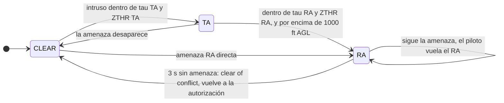
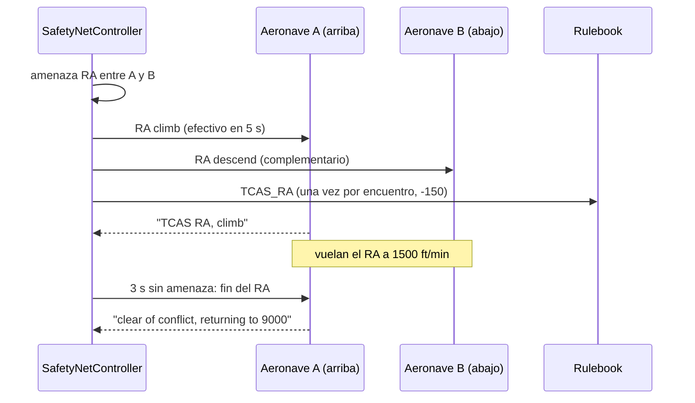

# Redes de seguridad: STCA, TCAS, MSAW y APW

Cuatro sistemas, como en la realidad, que avisan antes de que un conflicto llegue a ser una pérdida de
separación, una colisión con el terreno o una entrada en zona restringida. Viven en
`src/assets/scripts/client/safety/`: la lógica pura en `safetyNetLogic.js` (probada en
`test/safety/safetyNetLogic.spec.js`) y su integración en `SafetyNetController.js`, que el
`RealismController` ejecuta cada segundo de juego. Las reglas y sus valores están en la hoja de
especificaciones: [STC, TCA, MSW y APW](../especificacion/alertas.md).

| Sistema | Dónde actúa | Qué hace | Puntúa |
|---|---|---|---|
| **STCA** | En tierra, para el controlador | Predice cada pareja 120 s y avisa: ámbar si perderá la separación en ≤ 120 s, rojo si en ≤ 60 s | No (puntúa la pérdida de separación) |
| **TCAS II** | A bordo | TA (aviso de tráfico) y RA (aviso de resolución): el piloto sube, baja o nivela por encima de la autorización | `TCAS_RA` -150 una vez por encuentro |
| **MSAW** | En tierra | Avisa si una aeronave quedará por debajo de la MVA en 30 s | No (puntúa `MINIMUM_ALTITUDE_VIOLATION`) |
| **APW** | En tierra | Avisa si una aeronave entrará en una zona restringida por debajo de su techo en 60 s | No (puntúa `RESTRICTED_AREA_ENTRY`) |

Una orden de altitud contraria a un RA puntúa `INSTRUCTION_CONTRARY_TO_RA` (-300, nivel de seguridad).

## STCA

- Solo entre aeronaves controladas por encima de 1000 ft AGL (por debajo manda el control de aeródromo).
- Predicción lineal con la velocidad sobre el suelo y la velocidad vertical, **respetando la altitud
  autorizada** (una aeronave que sube a 9000 ft no se predice a 12 000 ft).
- Mínimas del perfil normativo del aeropuerto (3 NM y 1000 ft − 50 ft de tolerancia del modo C).
- No avisa de parejas separadas por otros medios, con las mismas exenciones que la regla de separación:
  misma final, aproximaciones paralelas independientes y salidas paralelas divergentes.

## TCAS II

- **Equipamiento:** todas las aeronaves salvo las de estela ligera (aproximación del mandato ACAS II europeo).
- **Umbrales** por nivel de sensibilidad (SL2 a SL7), según la altura sobre el terreno y la altitud: tau
  modificado horizontal con DMOD y tau vertical con ZTHR (tabla en [TCA-001](../especificacion/alertas.md#tca-001)).
- **Sentidos coordinados:** si nivelando las dos ya conservan ALIM, ambas nivelan; si no, la de arriba asciende
  y la de abajo desciende, sin cruzarse. Si la otra aeronave ya tiene un RA contra esta, se toma el sentido
  complementario.
- **Inhibiciones:** sin RA por debajo de 1000 ft AGL, sin RA de descenso por debajo de 1100 ft AGL, sin RA de
  ascenso en el techo de la aeronave.
- **Piloto:** tras 5 s de reacción sube o baja a 1500 ft/min (o nivela), comunica «TCAS RA, climb/descend/level
  off» y rechaza cualquier orden de altitud («unable, TCAS RA»). La autorización (altitud del MCP) se
  conserva: al terminar dice «clear of conflict, returning to …» y vuelve a ella.
- **Bots:** el escudo de seguridad no les deja dar órdenes de altitud ni de procedimiento a una aeronave en RA.

## MSAW y APW

- **MSAW:** solo en aeropuertos con terreno, para aeronaves controladas que no suben, fuera de la final y no
  saliendo a menos de 10 NM del aeropuerto. Descarta de inmediato a las que no pueden bajar de la MVA más alta
  del aeropuerto (así se evitan consultas de terreno costosas).
- **APW:** zonas restringidas del aeropuerto (`restricted`), por debajo de su techo.

## En el radar

El bloque de datos se pone **ámbar** (STCA preventiva, TA) o **rojo** (STCA alerta, RA, MSAW, APW) y muestra
encima el nombre de la alerta. Las emergencias mantienen su rojo propio.

## Opciones

- Juego: *Safety nets (STCA, TCAS, MSAW, APW)*: activadas por defecto.
- Headless: `run-bot.js --safety-nets off`, `HeadlessSimulator.reset(..., { safetyNets: false })`.

## Observación de los bots

`BotApi` añade a cada aeronave `safetyNet: { stca, tcas, raSense, msaw, apw }`. **Todavía no está en la
codificación del Bot B** (versión de features 7): entra en la versión 8, junto con la meteorología, para
reentrenar una sola vez.
