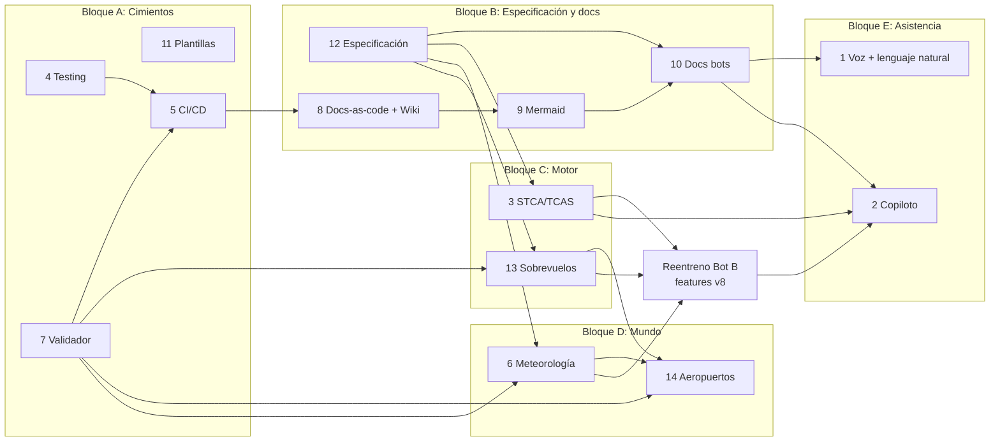
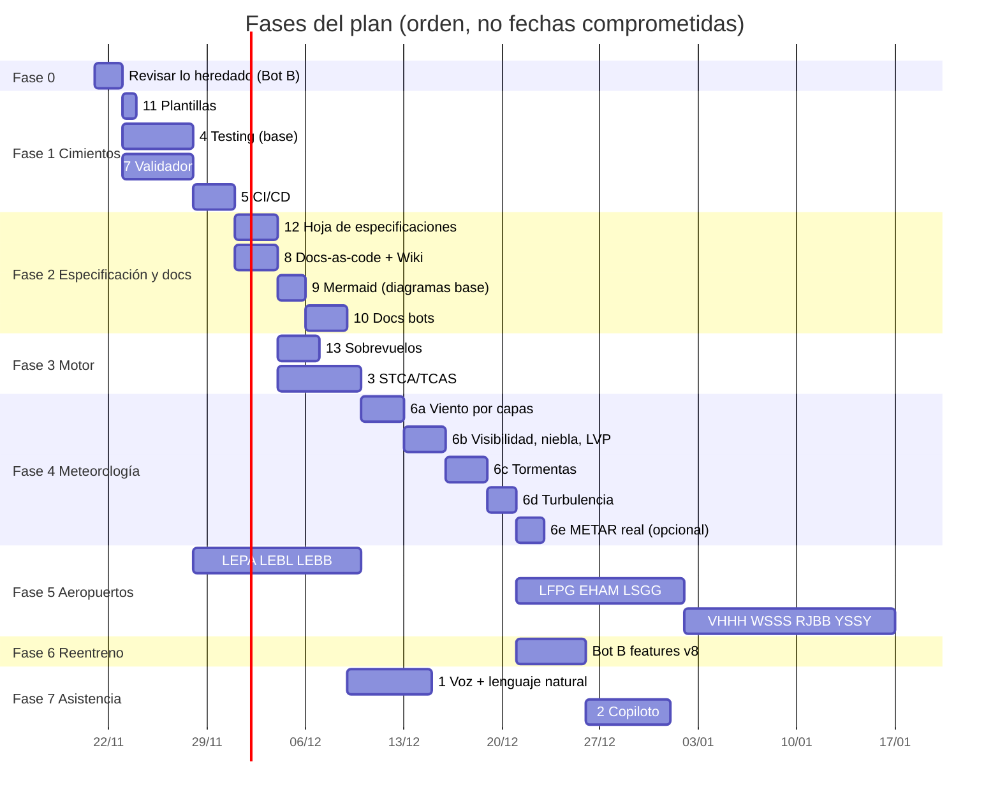
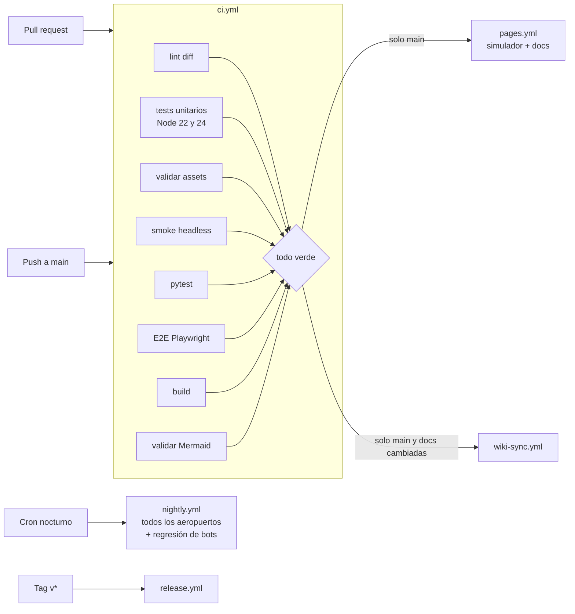
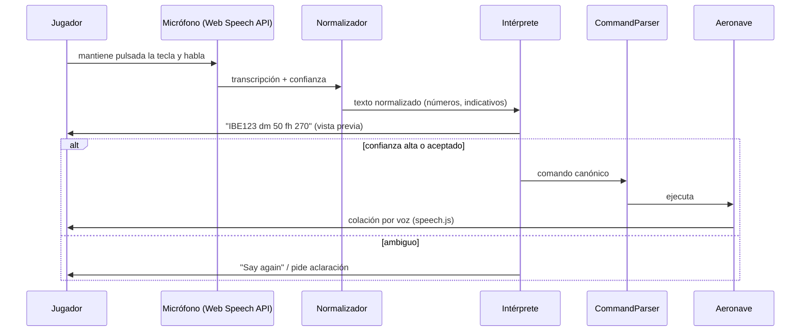

# phacer.md — Plan de trabajo del fork de openScope

> Documento vivo. Aquí se guarda todo lo pendiente, en curso y descartado, para poder retomarlo en cualquier sesión.
> Última revisión: 2026-11-20.

---

## 0. Cómo leer este documento

**Estados:** `[ ]` pendiente · `[~]` en curso · `[x]` hecho · `[-]` descartado (con motivo).

**Prioridad:**

| Código | Significado |
|---|---|
| **P0** | Base de todo lo demás. Sin esto, lo siguiente se construye sin red. |
| **P1** | Cambia el motor o las reglas: hay que hacerlo antes de reentrenar el Bot B. |
| **P2** | Mucho trabajo de datos o de motor, pero sin dependencias que bloqueen a otros. |
| **P3** | Funciones para el jugador que necesitan un motor y una documentación estables. |

**Esfuerzo (aproximado, en sesiones de trabajo):** S = 1 · M = 2-3 · L = 4-6 · XL = más de 6.

**Ficha de cada tarea:** objetivo → punto de partida (lo que ya hay en el repo) → diseño → tareas → criterios de aceptación → impacto en los bots → riesgos y preguntas abiertas.

---

## 1. Resumen: las 14 peticiones, agrupadas y priorizadas

| # | Petición | Bloque | Prioridad | Esfuerzo | Depende de |
|---|---|---|---|---|---|
| 11 | Plantillas de issues y PR | A. Cimientos | P0 | S | — |
| 4 | Testing automatizado | A. Cimientos | P0 | L | — |
| 5 | CI/CD con GitHub Actions | A. Cimientos | P0 | M | 4 |
| 7 | Validador de schemas de aeropuertos | A. Cimientos | P0 | L | — (se integra en 4 y 5) |
| 12 | Hoja de especificaciones físicas y reglas de dominio | B. Especificación y docs | P1 | M | — (antes de 3, 6 y 13) |
| 8 | Docs-as-code: carpeta `docs/` + MkDocs en Pages + GitHub Wiki | B. Especificación y docs | P1 | M | 5 |
| 9 | Diagramas Mermaid | B. Especificación y docs | P1 | M | 8 |
| 10 | Documentación del sistema de bots | B. Especificación y docs | P1 | M | 8, 9, 12 |
| 13 | Sobrevuelos | C. Motor: tráfico y seguridad | P1 | M | 7, 12 |
| 3 | STCA / TCAS (alertas de colisión) | C. Motor: tráfico y seguridad | P1 | L | 12 |
| 6 | Física y meteorología dinámica | D. Mundo simulado | P1/P2 | XL | 7, 12 |
| 14 | Aeropuertos nuevos y rehechos | D. Mundo simulado | P2 | XL | 7 (y 6, 13 para los campos nuevos) |
| 1 | Reconocimiento de comandos por voz y lenguaje natural | E. Asistencia al jugador | P3 | L | 10 (matriz de comandos) |
| 2 | Bot Copiloto | E. Asistencia al jugador | P3 | L | 3, 10, Bot C |

### Por qué este orden

1. **Primero los cimientos (bloque A).** Los workflows `pull-request.yml` y `push.yml` usan Node 11.3, `actions/*@v1-v2` y ramas `master`/`develop`, que en este fork no existen (la rama es `main`). Ahora mismo ningún cambio se comprueba de forma automática. El validador de aeropuertos va aquí porque cada aeropuerto nuevo (#14) y cada campo nuevo (#6, #13) lo necesitan.
2. **Después la especificación (#12).** STCA/TCAS, meteorología y sobrevuelos introducen constantes y reglas nuevas. Si se definen primero en una hoja con identificador, valor, unidad y fuente, el código y los tests citan ese identificador y no hay valores inventados repartidos por el código.
3. **Los cambios del motor que tocan la observación de los bots (#3, #6, #13) van juntos y antes de reentrenar el Bot B.** Cada cambio en `BotApi` o en `featureEncoder.js` obliga a subir la versión de features y a reentrenar. Agrupándolos se reentrena **una sola vez** (versión de features 8).
4. **Los aeropuertos (#14)** son sobre todo trabajo de datos. Los españoles pueden empezar en cuanto exista el validador. Los campos de meteorología y categoría ILS se añaden cuando exista #6.
5. **La asistencia al jugador (#1, #2) va al final.** Necesita la matriz de comandos (#10), las alertas (#3) y un planificador estable (Bot A/C).
6. **La documentación (#8, #9) se monta pronto y se rellena sobre la marcha.** Cada tarea de motor termina con su página de documentación y su diagrama: no es una fase aparte al final.

### Mapa de dependencias



### Calendario orientativo por fases



---

## 2. Reglas transversales (se aplican a todas las tareas)

- [ ] **Medir antes de aceptar.** Todo cambio que afecte al comportamiento de las aeronaves o de los bots se mide con el protocolo de 30 episodios (semillas 4-9 × LEMD N, LEMD S, EDDM, LEMG, KLAX, emergencias 0) y se juzga por la **puntuación total**, no por los aterrizajes. Una pérdida de separación radar (-200) borra unos 20 movimientos.
- [ ] **Versión de features del Bot B.** Si cambia la observación (`BotApi`) o el espacio de acciones (`actionSpace.js`), se sube la versión de features y se anota aquí. Los cambios se acumulan para reentrenar una sola vez (sección 9).
- [ ] **PRNG propio por sistema nuevo.** Igual que `EmergencyController` (semilla + 7700): meteorología, sobrevuelos y STCA no deben cambiar el tráfico generado al activarlos o desactivarlos. Propuesta: meteorología semilla + 8800, sobrevuelos usan el `SpawnScheduler` normal.
- [ ] **Opciones de juego.** Cada sistema nuevo tiene opción propia en el menú y opción equivalente en headless (`run-bot --<opción>`, `reset(..., { ... })`, Python).
- [ ] **Probar como juega el usuario.** Además de los bots, probar siempre `new HeadlessSimulator({ towerController: 'SYSTEM' })` sin bot, y mirar qué se ve en pantalla al empezar (el zoom por defecto solo muestra unas 36 NM).
- [ ] **Datos reales.** Coordenadas, fijos y procedimientos se comprueban contra el AIP vigente. Las listas pegadas desde chatbots han tenido errores de 10-12 NM.
- [ ] **Cada tarea termina con:** tests, entrada en la hoja de especificaciones (si añade reglas), página en `docs/`, diagrama si aplica, entrada en `CHANGELOG.md` y actualización de este archivo.
- [ ] **Idioma.** Documentación y textos de interfaz nuevos en español. Identificadores de código, nombres de archivo y comentarios técnicos en inglés, como el resto del motor.
- [ ] **Saltos de línea.** Los fuentes del motor están en CRLF en la copia de trabajo: ESLint local con `--rule 'linebreak-style: off'`. Decidir en #5 si se añade `.gitattributes`.

---

## 3. Bloque A — Cimientos de calidad (P0)

### 3.1 [#11] Plantillas de issues y pull requests — P0 · S

> **Estado 2026-11-20: hecho, falta verlo en GitHub tras el push.** Creados `.github/ISSUE_TEMPLATE/` (`config.yml`, `bug.yml`, `feature.yml`, `airport.yml`, `bot-regression.yml`, `docs.yml`), `.github/pull_request_template.md`, `.github/labels.yml` y el workflow `labels.yml` (`crazy-max/ghaction-github-labeler@v5`, sin borrar etiquetas). Borradas las plantillas antiguas de la raíz. Todos los YAML se leen sin errores. En `bug.yml` el aeropuerto es un campo de texto, no un desplegable (hay más de 60 activos).

**Objetivo:** que cada issue y cada PR lleguen con la información necesaria para reproducir el problema o revisar el cambio, en español.

**Punto de partida:** `ISSUE_TEMPLATE.md` y `PULL_REQUEST_TEMPLATE.md` en la raíz, heredados de openScope, en inglés y genéricos.

**Diseño:** formularios de issue en YAML (GitHub Issue Forms), que obligan a rellenar campos.

**Tareas:**
- [ ] `.github/ISSUE_TEMPLATE/config.yml`: desactivar issues en blanco; enlaces a la documentación y a la Wiki.
- [ ] `.github/ISSUE_TEMPLATE/bug.yml`: aeropuerto (desplegable), navegador y versión, modo (manual / Bot A / B / C / copiloto), semilla, opción de torre (USER/SYSTEM), pasos, resultado esperado frente a obtenido, registro de puntuación pegado, consola del navegador y captura.
- [ ] `.github/ISSUE_TEMPLATE/feature.yml`: problema, propuesta, alternativas, impacto en bots (sí/no: ¿cambia la observación?), reglas afectadas (ID de la hoja de especificaciones).
- [ ] `.github/ISSUE_TEMPLATE/airport.yml`: ICAO, fuentes AIP y ciclo AIRAC, lista de comprobación (pistas, espacio aéreo, SID/STAR, terreno, aerolíneas, sobrevuelos, meteorología, validador sin errores, vuelo headless).
- [ ] `.github/ISSUE_TEMPLATE/bot-regression.yml`: bot, versión, tabla del protocolo de 30 episodios (antes/después: puntuación, aterrizajes, pérdidas, tier 0/1).
- [ ] `.github/ISSUE_TEMPLATE/docs.yml`: página afectada y qué falta o está mal.
- [ ] `.github/pull_request_template.md`: tipo de cambio, issue relacionada, descripción, lista de comprobación (tests, validador, docs, Mermaid actualizado, CHANGELOG, ¿sube la versión de features?, resultados del protocolo si toca bots o motor, capturas si toca la interfaz).
- [ ] `.github/labels.yml` y workflow que sincroniza etiquetas: `tipo:bug`, `tipo:mejora`, `tipo:docs`, `area:motor`, `area:bots`, `area:aeropuertos`, `area:meteo`, `area:ci`, `prioridad:P0-P3`, `bot-b:reentreno`.
- [ ] Borrar las plantillas antiguas de la raíz.

**Aceptación:** al abrir una issue en GitHub aparecen los formularios. Un PR de prueba muestra la plantilla.

---

### 3.2 [#4] Testing automatizado — P0 · L

> **Estado 2026-11-20: capas 1, 3, 4 y 5 hechas; faltan la capa 2 (llega con #7), la 6 (E2E) y los tests de módulos sin cubrir.**
> - Línea base: 1475 tests pasan, 17 omitidos y 14 `todo`, en 58 s con **Node 24.21**. AVA 1.4.1 funciona en Node 24: no hace falta migrar.
> - **nyc 14.1.0 no arrancaba en Node 24** (dependía del paquete `esm`): actualizado a nyc 15.1.0. `npm test` vuelve a funcionar, con cobertura del 67,8 % de sentencias, 54,9 % de ramas, 69,8 % de funciones y 67,5 % de líneas. Efecto secundario: npm 11 reescribió `package-lock.json` del formato v1 al v3 (unas 26 000 líneas de diff); la build (`npm run build`) funciona con él. `.npmrc` gana `legacy-peer-deps=true`, porque `lint-diff` 1.2.1 pide eslint 4 y el proyecto usa eslint 5: npm 6 no lo comprobaba y npm 7+ sí. Comprobado en una carpeta limpia: `npm ci` y los scripts de instalación (`npm rebuild`) funcionan, así que **ya no hace falta `--ignore-scripts`**. Quitado Coveralls (script y dependencia).
> - `engines` → `node >=22`; `.nvmrc` 11.3.0 → 24.
> - Scripts nuevos: `test:unit`, `test:headless` (Bot A 20 min en LEMD, LEMG, EDDM, KLAX y EGCC, unos 30 s), `test:bots` (regresión rápida, 10 episodios) y `test:py`.
> - `check-airports.js --strict`: sale con código 1 si falla algún aeropuerto.
> - **`tools/sim/regression.js`** ejecuta el protocolo de 30 episodios y compara con `bots/baselines/bot<A|C>.json`. El simulador es determinista (misma semilla → mismo resultado exacto), así que la tolerancia es pequeña: puntuación -2 % del valor absoluto, y ningún aumento de tier 0. Líneas base: **Bot A -3945** (494 aterrizajes, 539 despegues, 43 pérdidas, 5 de estela, tier0 5), igual que la medición «vF» del 17-11, y **Bot C -5980** (501 / 538 / 57 / 7 / tier0 2). Unos 10 min por bot con 7 procesos.
> - Python: no hacía falta pytest, porque los tests usan `unittest` (15 en verde). Creado `bots/python/requirements.txt`, que no existía (torch 2.11.0, numpy 2.4.6, gymnasium 1.4.0, onnx 1.23.2, onnxruntime 1.31.1).
> - Documentación: `docs/desarrollo/testing.md`.
> - Pendiente: E2E con Playwright; tests de `SpawnScheduler.arrivalSpawn` y de `AircraftConflict`; capa de assets con #7.

**Objetivo:** que cualquier cambio se pueda comprobar en minutos, en local y en CI, con capas desde tests unitarios hasta el simulador completo.

**Punto de partida:**
- 98 archivos `*.spec.js` con AVA 1.4.1 + nyc (`npm test`), incluidos `test/bot/` (12) y `test/realism/` (10).
- `package.json` declara `engines: node 11.3.0`, pero la máquina usa Node 24.21 y el workflow de Pages también.
- Para instalar hace falta `npm install --ignore-scripts` (y restaurar `package-lock.json` después).
- Python: `bots/python/tests/test_bots.py` y `test_client.py`; pytest no está en el venv.
- `tools/sim/check-airports.js` ya vuela todos los aeropuertos en headless.

**Diseño por capas:**

| Capa | Herramienta | Qué comprueba | Dónde corre |
|---|---|---|---|
| 1. Unitarios del motor | AVA + nyc | Funciones y modelos aislados | Cada PR |
| 2. Assets | Validador (#7) | Cada JSON de aeropuerto, aeronave y aerolínea | Cada PR |
| 3. Integración headless | `HeadlessSimulator` | Episodio de 5 min por aeropuerto sin excepciones, sin NaN en posiciones, sin aeronaves perdidas al aparecer | Cada PR (subconjunto) y nightly (todos) |
| 4. Regresión de bots | `run-bot` | Puntuación del Bot A y C en un subconjunto fijo de semillas no peor que la línea base | Nightly / manual |
| 5. Python | pytest | Cliente, entorno Gymnasium, codificación | Cada PR |
| 6. Navegador (E2E) | Playwright | Carga la página, elige aeropuerto, da un comando, sin errores en consola, captura | Cada PR (1 aeropuerto) |

**Tareas:**
- [ ] **Línea base:** ejecutar `npm test` en Node 24 y anotar aquí cuántos pasan, fallan o no arrancan. Decidir si AVA 1.4.1 funciona en Node 24 o si hay que actualizar (AVA 6 + `@babel/register`, o migrar a `node:test`). Preferencia: actualizar AVA para no reescribir 98 archivos.
- [ ] Actualizar `engines` en `package.json` a la versión LTS elegida (propuesta: `>=22`) y añadir `.nvmrc`.
- [ ] Arreglar la instalación para que `npm ci` funcione sin `--ignore-scripts` (identificar qué script falla).
- [ ] Scripts npm: `test:unit`, `test:assets`, `test:headless`, `test:bots`, `test:e2e`, `test:py`, y `test` = unit + assets.
- [ ] `test/headless/smoke.spec.js`: para cada aeropuerto de una lista corta (LEMD, LEMG, EDDM, KLAX, EGCC) corre 5 minutos con semilla fija y comprueba: sin excepciones, posiciones finitas, ninguna aeronave fuera del espacio aéreo al aparecer, puntuación no NaN.
- [ ] `tools/sim/regression.js`: corre el subconjunto de bots y compara con `bots/baselines/<bot>.json` (puntuación total, pérdidas, aterrizajes). Falla si la puntuación empeora más que el ruido medido (calcular el ruido con 3 repeticiones; empezar con un margen del 5 %).
- [ ] Python: añadir `pytest` a los requisitos de desarrollo (`bots/python/requirements-dev.txt`) y un `conftest.py` que arranque el simulador Node una sola vez por sesión.
- [ ] Playwright: `test/e2e/load.spec.js` con `npm run build` + `npm start` en el puerto 3003.
- [ ] Tests para lo que hoy no tiene: `AuditController` (codificación con `CommandHistory`, pendiente heredado), `SpawnScheduler.arrivalSpawn`, `AircraftConflict`.
- [ ] Objetivo de cobertura: todo módulo nuevo al menos un 80 % de líneas. Informe de nyc publicado como artefacto de CI.
- [ ] Documentar en `docs/desarrollo/testing.md`: cómo correr cada capa, cómo añadir un test, cómo actualizar una línea base.

**Aceptación:** `npm test` pasa en limpio en Node LTS. Cada capa tiene al menos un test que falla si se rompe aposta lo que comprueba.

**Riesgos:** AVA antiguo con Babel 7 puede no arrancar en Node 24, lo que obligaría a actualizar dependencias en cadena (gulp 4, babel). Los episodios headless largos no caben en CI por cada PR.

---

### 3.3 [#5] Integración y despliegue continuos con GitHub Actions — P0 · M

> **Estado 2026-11-20: hecho lo principal; sin probar en GitHub hasta el push.**
> - Borrados `pull-request.yml` y `push.yml`.
> - `ci.yml`: lint-diff (base del PR o `github.event.before`), unitarios con cobertura en Node 22 y 24 (artefacto `coverage`), headless, Python (torch CPU) y build.
> - `pages.yml` publica solo cuando `ci.yml` termina bien en un push a `main` (`workflow_run`, con checkout del commit comprobado).
> - `nightly.yml` (03:00 UTC): todos los aeropuertos + regresión completa de los bots A y C; si empeora, abre una issue (una sola mientras siga abierta).
> - `dependabot.yml`: Actions semanal; npm solo avisos de seguridad.
> - README: insignias de este fork en vez de las del openScope original (y quitada la de Coveralls).
> - Lint-diff probado sobre el último commit de bots: solo 2 avisos `max-len`. Los errores `linebreak-style` son de la copia de trabajo en Windows: el repo guarda LF, así que en CI no aparecen. **Ya no hace falta `.gitattributes`.**
> - Documentación: `docs/desarrollo/ci.md`, con los pasos de protección de `main`.
> - Pendiente: trabajos `assets` (#7), `mermaid` y `docs` (#8/#9), E2E (#4), `release.yml`; **protección de `main` en GitHub (la configura el usuario)**.

**Objetivo:** cada PR y cada push a `main` pasan lint, tests, validación de assets y build. `main` se despliega solo (simulador + documentación + Wiki).

**Punto de partida:** `pages.yml` (Node 24, construye y publica en Pages, funciona). `pull-request.yml` y `push.yml` obsoletos (Node 11.3, `actions/checkout@v2`, `setup-node@v1`, ramas `master`/`develop`, Coveralls).

**Diseño de workflows:**



**Tareas:**
- [ ] Borrar `pull-request.yml` y `push.yml`.
- [ ] `ci.yml` (en `pull_request` y `push` a `main`), con trabajos paralelos y caché de npm y pip:
  - `lint`: ESLint sobre los archivos cambiados (`lint-diff`), Node 24.
  - `unit`: matriz Node 22 y 24, `npm run test:unit`, sube el informe de cobertura como artefacto.
  - `assets`: `npm run validate:airports` (#7). Falla si hay errores; los avisos van al resumen del job.
  - `headless`: smoke de 5 aeropuertos.
  - `python`: Python 3.12, `pip install -r bots/python/requirements-dev.txt` (torch CPU), `pytest`.
  - `e2e`: Playwright con Chromium.
  - `build`: `npm run build` (artefacto `public/`, reutilizable por `pages.yml`).
  - `mermaid`: valida que todos los bloques ```mermaid de `docs/` se pueden dibujar (`@mermaid-js/mermaid-cli`).
  - `docs`: `mkdocs build --strict` (enlaces rotos = fallo).
- [ ] `pages.yml`: se ejecuta solo si `ci.yml` pasa en `main` (`workflow_run`, o integrarlo como último trabajo). Publica el simulador en `/openScope/` y la documentación en `/openScope/docs/`.
- [ ] `wiki-sync.yml`: ver #8.
- [ ] `nightly.yml` (cron 03:00 UTC + manual): `check-airports` de todos los aeropuertos y regresión de bots reducida (6 episodios, el runner tiene 2 núcleos y 6 h como máximo). Resultado en el resumen del job; si empeora, abre una issue con la plantilla `bot-regression`.
- [ ] `release.yml`: en tag `v*`, crea una release con el fragmento correspondiente de `CHANGELOG.md` y el ZIP de `public/`.
- [ ] `.github/dependabot.yml`: actualizaciones semanales de GitHub Actions; npm solo para avisos de seguridad (las dependencias del motor son antiguas y se actualizan a mano).
- [ ] Fijar versiones de las actions por versión mayor (`actions/checkout@v4`, `actions/setup-node@v4`, `actions/setup-python@v5`).
- [ ] Decidir sobre Coveralls: propuesta, quitarlo y publicar la cobertura en el resumen del job.
- [ ] `.gitattributes` (`* text=auto eol=lf` para `.js`/`.json`/`.md`): decidirlo con el usuario, porque cambia todos los archivos en el primer commit.
- [ ] Documentar en `docs/desarrollo/ci.md` y añadir insignias de estado al README.
- [ ] **(Lo hace el usuario en GitHub)** protección de `main`: exigir `ci.yml` verde antes de fusionar.

**Aceptación:** un PR con un test roto queda en rojo; un PR con un aeropuerto inválido queda en rojo; un push a `main` despliega simulador y documentación.

---

### 3.4 [#7] Validador automático de schemas de aeropuertos — P0 · L

> **Estado 2026-11-20: núcleo hecho (schema + 14 reglas + CLI + CI + tests + docs). Faltan la integración en ejecución, los schemas de aeronaves y aerolíneas, y el conversor del formato antiguo.**
> - `assets/airports/schema/airport.schema.json` (draft 2019-09, ajv 8.17.1), escrito a partir de lo que leen `AirportModel`, `SpawnPatternModel`, `RunwayModel` y `MapModel`. Admite las formas reales que el motor acepta: altura `"Infinity"`, tramos de un elemento, altitud y velocidad como texto numérico, elevación sin unidad (pies) y SID sin `body`.
> - `tools/validate/rules.js`: reglas AP-001 a AP-014. La numeración final difiere de la tabla de abajo; la tabla vigente está en `docs/aeropuertos/validador.md`. AP-005 clasifica cada nombre de la ruta (fijo, procedimiento, aerovía o aeropuerto con pista) en vez de reimplementar el parser del motor.
> - `tools/validate/validate-airports.js` → `npm run validate:airports` (`--all`, `--json`, `--quiet`); sale con 1 si hay errores. Usa el `parseCoordinate` del motor.
> - `tools/validate/known-issues.json`: KBNA (`HRTUN`) y KSLC (`CCHIP`), fijos sin definir en STAR que no usa ningún spawn pattern. Falta la coordenada real.
> - **Datos corregidos:** RJAA (coordenada de `_NRE045021`), LTBA (16 coordenadas de mapa con d/m invertidos), EGNM (polilínea de 121 puntos → 120 segmentos), KIAD (`n/fastGA` sin peso → 1) y EDDF (fijo `tau` → `TAU`). Los cuatro primeros vuelan en headless; EGNM puntúa -2825 con y sin el arreglo (problema previo de tráfico, no del mapa).
> - **Resultado:** 66 aeropuertos activos con 0 errores y 10 con avisos (SID/STAR con `icao` distinto de la clave en EGCC, EICK, KCLT, KJAX y RJAA; sectores de grosor cero en KEWR y KLAX; un polígono que se cruza en KLAX; rumbo 15° desviado en KMCO). 38 de los 40 desactivados no pasan el schema (formato antiguo de mapas).
> - Retirado `@openscope/validator` y el script roto `validator`. Trabajo `assets` en `ci.yml`. 16 tests en `test/tools/validateAirports.spec.js`. Documentación en `docs/aeropuertos/validador.md`.
> - Pendiente: validar en `AirportController` en la build de desarrollo; schemas de `aircraft/*.json` y `airlines/*.json`; reglas que necesitan geometría con la ruta (aparición dentro del espacio aéreo, STAR por encima del suelo, rutas que cruzan zonas restringidas); conversor del formato antiguo de mapas; campos de #6 y #13 cuando existan; generar `docs/referencia/formato-aeropuerto.md` desde el schema.

**Objetivo:** ningún aeropuerto llega al simulador (ni a `main`) sin cumplir el formato y unas reglas de coherencia. Hoy un error en el JSON se descubre jugando o con un bot que falla.

**Punto de partida:**
- Solo existe `assets/airports/airportLoadList.schema.json` (draft 2019-09).
- `npm run validator` usa `@openscope/validator` en versión `latest` (instalada la 2.4.1). Hay que revisar qué comprueba antes de decidir si se amplía o se sustituye.
- Formato documentado en `documentation/airport-format.md` y `airport-file-standards.md`.
- Particularidades del motor: los nombres de flota en los spawn patterns distinguen mayúsculas (`ec/fastGA`); una aeronave que sale de todo polígono de `airspace` (lateral o por debajo del suelo) se elimina con AIRSPACE_BUST -200.

> **Revisión de `@openscope/validator` 2.4.1 (2026-11-20):** usa tcomb con un esquema estricto del openScope original. Rechaza LEMD y LEMG por propiedades propias de este fork (`runwayConfiguration` en los spawn patterns) y EGLL por `restricted` sin `coordinates` y pistas sin `glideslope`. Además, `npm run validator` (`validator -a` sin ICAO) está roto, y la dependencia se declara como `latest`. **Decisión: sustituirlo** por el validador propio descrito abajo, y quitar la dependencia y el script cuando el nuevo funcione. Sus comprobaciones de fijos sin definir y coordenadas válidas sirven de lista mínima de reglas.

**Diseño: dos niveles.**

1. **Schema (estructura):** `assets/airports/schema/airport.schema.json` (draft 2019-09, igual que el existente), dividido en `$defs` (`runway`, `fix`, `airspace`, `procedure`, `spawnPattern`, `arrivalSpawn`, `wind`, `weather`, `restricted`, `maps`). Validación con **ajv** (versión fija, con `ajv-formats`). Schemas también para `aircraft/*.json` y `airlines/*.json`.
2. **Reglas semánticas (coherencia):** `tools/validate/rules/*.js`. Cada regla tiene ID (`AP-xxx`), gravedad (`error` bloquea, `aviso` informa) y mensaje en español con la ruta JSON del fallo.

**Reglas semánticas iniciales:**

| ID | Gravedad | Regla |
|---|---|---|
| AP-001 | error | El nombre del archivo coincide con `icao` en minúsculas y existe en `airportLoadList.json` |
| AP-002 | error | Cada pista tiene su recíproca, rumbos opuestos ±5°, y la distancia entre umbrales coincide con la longitud declarada ±2 % |
| AP-003 | error | Todo fijo usado en SID, STAR, aproximaciones, spawn patterns y `arrivalSpawn` existe en `fixes` |
| AP-004 | error | Las pistas citadas en procedimientos existen |
| AP-005 | error | Las rutas de los spawn patterns se resuelven con el navigation library real del motor (no reimplementar el parser) |
| AP-006 | error | Aerolíneas y flotas de los spawn patterns existen (mayúsculas exactas) |
| AP-007 | error | Polígonos de espacio aéreo cerrados, sin autointersecciones, suelo < techo |
| AP-008 | error | Punto y altitud de aparición de cada llegada dentro de algún polígono y por encima de su suelo |
| AP-009 | aviso | Restricciones de altitud de las STAR por encima del suelo del sector que atraviesan |
| AP-010 | aviso | Existe el archivo de terreno si el aeropuerto declara terreno |
| AP-011 | aviso | Los aeropuertos españoles (`le*`) tienen `arrivalSpawn` (preSpawn false, intervalo mínimo) |
| AP-012 | error | Los sobrevuelos (#13) entran y salen del espacio aéreo y su altitud está entre suelo y techo |
| AP-013 | aviso | Elevación del aeropuerto coherente con el terreno en el punto de referencia (±150 ft) |
| AP-014 | error | Bloque `weather` y `ilsCategory` válidos cuando existan (#6) |
| AP-015 | aviso | Ninguna ruta de llegada cruza una zona restringida por debajo de su techo |

**Tareas:**
- [ ] Revisar `@openscope/validator` 2.4.1: qué comprueba y si se puede ampliar. Fijar su versión (hoy `latest`).
- [ ] Escribir el schema a partir de la documentación y del parseo real en `AirportModel.js` (lo que el código lee manda sobre lo que dice la documentación).
- [ ] Probar el schema contra los ~105 aeropuertos actuales y anotar los que fallan. Los antiguos que no se rehacen pueden quedar con avisos, nunca con errores que impidan cargarlos.
- [ ] Implementar las reglas AP-001 a AP-015 con tests (un fixture válido y uno inválido por regla).
- [ ] CLI `npm run validate:airports [icao...]`: informe en consola con colores, salida JSON para CI (`--json`), código de salida 1 si hay errores.
- [ ] Integración en ejecución: en la build de desarrollo, `AirportController` valida antes de cargar y, si hay errores, muestra un aviso legible en vez de romper. En producción solo una comprobación ligera, para no cargar ajv en el cliente si pesa demasiado.
- [ ] Integración en CI (#5) y en las plantillas (#11).
- [ ] Generar documentación de referencia del formato a partir del schema (`docs/referencia/formato-aeropuerto.md`) para que no diverja.
- [ ] Documentar en `docs/aeropuertos/validador.md`: cómo se usa, tabla de reglas y cómo añadir una.

**Aceptación:** LEMD y LEMG pasan sin errores. Romper a propósito un fijo, una flota o un polígono da un error con la ruta exacta. CI bloquea el PR.

---

## 4. Bloque B — Especificación y documentación (P1)

### 4.1 [#12] Hoja de especificaciones físicas y reglas de dominio — P1 · M

> **Estado 2026-11-20: hecho (base). Se completa con #3 (STC/TCA) y #6 (MET).**
> - Fuente única `docs/especificacion/reglas.yaml`: 63 reglas en 16 dominios. Hay 4 pendientes (STC-001, TCA-001, MET-001 y la puntuación provisional SCO-004) y 3 de referencia o parciales (ATM-001, ATM-002, ATM-004).
> - `tools/docs/generate-spec.js` genera `docs/especificacion/*.md` (8 páginas + índice con matriz de trazabilidad). `--check` en CI.
> - `test/spec/reglas.spec.js`: 36 tests comparan el YAML con el código: valores exportados, las 6 tablas de estela evaluadas par a par con las funciones reales, puntuación completa y niveles y referencias del Rulebook. Ya detectó dos referencias mal transcritas.
> - **Auditoría de física:** TAS = IAS × (1 + 0,000016 × alt), es decir +1,6 % por 1000 ft (el comentario del código dice 0,16 %). Frente a ISA se queda corto en altura (FL240: ×1,38 frente a ×1,45; FL390: ×1,62 frente a ×2,0). El viento crece un 2 % por 1000 ft sin girar con la altura. No hay QNH ni altitud de transición. `FLIGHT_PHASE.HOLD` no la activa ningún código. Todo anotado en ATM-001..004 y UNI-005.
> - Las constantes privadas (sin export) se documentan con archivo y nombre, sin test automático.

**Objetivo:** una única fuente de verdad con todas las constantes físicas y reglas ATC del simulador: valor, unidad, fuente normativa, dónde está implementada y qué test la comprueba. Es la base de STCA/TCAS, meteorología, sobrevuelos y la documentación de los bots.

**Punto de partida:** constantes repartidas (`constants/aircraftConstants.js`: `SEPARATION` 3 NM / 1000 ft / 8 NM; `environmentConstants.js`: viento +2 % por cada 1000 ft; `realism/wakeTurbulence.js`, `regulatoryProfiles.js` con EASA/RECAT-EU, FAA 7110.65 e ICAO; `Rulebook.js` con niveles; puntuación en `GameController.js`). Documentos parciales: `aircraft-separation.md`, `realism.md`, `scoring.md`.

**Diseño:**
- `docs/especificacion/` con una página por dominio y una tabla por página: `ID | Regla o constante | Valor | Unidad | Fuente | Implementado en | Test`.
- IDs estables por dominio: `UNI-` unidades, `ATM-` atmósfera, `VEL-` velocidades, `PER-` rendimiento, `SEP-` separación, `WAK-` estela, `DEP-` salidas, `APP-` aproximación, `PAR-` paralelas, `ASP-` espacio aéreo, `TER-` terreno, `EMG-` emergencias, `SCO-` puntuación, `MET-` meteorología, `STC-` STCA, `TCA-` TCAS, `OVF-` sobrevuelos.
- Espejo legible por máquina `docs/especificacion/reglas.yaml` y un test que comprueba que los valores del YAML coinciden con las constantes del código (así la hoja no se queda desactualizada).
- El código y los tests citan el ID en un comentario (`// SEP-002`).

**Contenido mínimo:**
- [ ] **Unidades y referencias:** NM, ft, kt, ft/min; coordenadas WGS-84; rumbos magnéticos y declinación por aeropuerto; altitud frente a nivel de vuelo; altitud de transición por aeropuerto (según AIP).
- [ ] **Atmósfera ISA:** 15 °C y 1013,25 hPa al nivel del mar, gradiente -1,98 °C/1000 ft, tropopausa a 36 089 ft. Conversión IAS↔TAS↔Mach↔GS. **Auditar primero qué hace hoy el motor** (si usa IAS o TAS para el movimiento y cómo aplica el viento).
- [ ] **Velocidades:** 250 kt por debajo de FL100 (España: según AIP/SERA), velocidades de aproximación por categoría ICAO A-E, 160 kt hasta 4 NM como práctica de estabilización.
- [ ] **Rendimiento:** régimen de viraje estándar 3°/s, alabeo máximo 25-30°, ascenso y descenso desde `aircraft.json`.
- [ ] **Separación:** 3 NM en TMA y 5 NM en ruta, 1000 ft vertical (RVSM FL290-FL410), dependiente frente a independiente en paralelas.
- [ ] **Estela:** tabla RECAT-EU (categorías A-F, distancias en NM y tiempos en salida), tal como está en `wakeTurbulence.js`.
- [ ] **Salidas:** separación de 1-2 min, regla de divergencia de 45°, V1 = 0,9 × velocidad mínima para cancelar el despegue (decisión ya tomada).
- [ ] **Aproximación:** senda de 3°, FAF, puerta de estabilización a 1000 ft AGL, compresión en las últimas 5 NM.
- [ ] **Espacio aéreo y terreno:** clases, suelos escalonados, AIRSPACE_BUST, MVA, MSA, zonas restringidas.
- [ ] **Puntuación:** tabla completa de eventos (SEPARATION_LOSS -200, WAKE_SEPARATION_LOSS -100, AIRSPACE_BUST -200, EMERGENCY_LANDING +50, EMERGENCY_DEADLINE_MISSED -300, cancelación injustificada -50, llegadas y salidas ~+10...) leída de `GameController.js`.
- [ ] **Secciones que se rellenan con cada tarea:** `MET-` (#6), `STC-` y `TCA-` (#3), `OVF-` (#13).
- [ ] **Matriz de trazabilidad:** regla → código → test → documentación. Una regla sin test aparece marcada.

**Aceptación:** cada constante de `SEPARATION`, estela, puntuación y emergencias aparece con fuente y test. El test YAML↔código pasa.

---

### 4.2 [#8] Docs-as-code: carpeta `docs/` + MkDocs en Pages + GitHub Wiki — P1 · M

> **Estado 2026-11-20: hecho; falta la primera ejecución en GitHub (y crear la Wiki a mano una vez).**
> - `documentation/` → `docs/` con `git mv` (se conserva el historial) y nombres en español: `guia-jugador/`, `aeropuertos/` (guías en `aeropuertos/guias/`), `motor/`, `bots/`, `desarrollo/`, `especificacion/`, `adr/`. 72 enlaces reescritos (docs, README, CONTRIBUTING, READMEs de herramientas).
> - La build lee las guías desde `docs/aeropuertos/guias` (`tools/options.js`); comprobado que `guides.json` se sigue generando.
> - 19 documentos en inglés llevan el aviso «Documento en inglés… se traducirá cuando se modifique».
> - `mkdocs.yml` (Material 9.5.49, español, Mermaid, búsqueda, fecha por git, anclajes como los de GitHub con tildes); `docs/requirements.txt`. `mkdocs build --strict` sin avisos. Quedan 3 anclajes rotos (nivel info) en documentos heredados.
> - Publicación: `pages.yml` construye la documentación en `public/docs/` → `https://jossseluuu.github.io/openScope/docs/`.
> - **Wiki:** `tools/docs/build-wiki.js` (páginas planas, enlaces reescritos, `_Sidebar.md` desde la navegación, aviso en cada página) + `wiki-sync.yml`. Probado en local: 134 páginas. **Requisito manual:** crear una primera página en la Wiki desde GitHub para que exista `openScope.wiki.git`.
> - Portada `docs/index.md`, `desarrollo/documentar.md` y 5 ADR (`docs/adr/`).
> - CI: trabajo `docs` (generadores al día, diagramas Mermaid, `mkdocs build --strict`).

**Decisión del usuario (2026-11-20):** la documentación vive a la vez en `docs/` (MkDocs publicado en Pages) y en la GitHub Wiki.

**Propuesta para que no diverjan:** `docs/` es la **única fuente**. La Wiki se **genera automáticamente** desde `docs/` en cada push a `main` y lleva un aviso en cada página: «Esta página se genera desde docs/; edítala allí».

**Punto de partida:** `documentation/` con unos 30 `.md` en inglés y español mezclados (bots, emergencias y entrenamiento en español; formatos heredados en inglés) y `documentation/airport-guides/`. **Verificar antes de mover nada** si la build o la app consumen `documentation/airport-guides` (`AirportGuideViewController`, `tools/tasks/markdownAssembler.js`).

**Estructura propuesta:**

```
docs/
├── index.md                    # qué es el fork, enlaces rápidos, estado
├── guia-jugador/               # cómo jugar, comandos, voz (#1), copiloto (#2), emergencias, meteorología (#6)
├── aeropuertos/                # lista, guías por aeropuerto, cómo crear uno, validador (#7)
├── motor/                      # arquitectura, bucle de simulación, aeronaves, FMS, STCA/TCAS (#3), meteorología (#6), sobrevuelos (#13)
├── especificacion/             # hoja de especificaciones (#12)
├── bots/                       # Bot A, B, C, razonamiento, matriz de comandos (#10), entrenamiento
├── desarrollo/                 # entorno, testing (#4), CI/CD (#5), contribuir, flujo git, plantillas (#11)
├── referencia/                 # formatos generados desde los schemas, comandos generados desde aircraftCommandMap.js
├── adr/                        # registros de decisiones de arquitectura (formato MADR)
└── changelog.md
```

**Tareas:**
- [ ] `mkdocs.yml` con MkDocs Material (versión fija en `docs/requirements.txt`): idioma `es`, búsqueda en español, Mermaid vía `pymdownx.superfences`, modo oscuro, `edit_uri` apuntando al repo, plugin de fecha de última modificación por git.
- [ ] Migrar `documentation/*.md` a la nueva estructura: traducir al español lo heredado que sea útil, y marcar como «heredado de openScope» lo que no se toca. Dejar en `documentation/README.md` un aviso con enlace a `docs/`, o redirecciones si la app las usa.
- [ ] Generadores en `tools/docs/` (los ejecuta CI y falla si el resultado difiere de lo committeado):
  - `generateCommandReference.js` (desde `aircraftCommandMap.js` y `scopeCommandMap.js`),
  - `generateAirportFormat.js` (desde el schema de #7),
  - `generateBotMatrix.js` (#10),
  - `generateAirportList.js` (desde `airportLoadList.json`).
- [ ] Publicación: `pages.yml` construye `mkdocs build` y lo copia a `public/docs/`.
- [ ] `wiki-sync.yml`: en push a `main` con cambios en `docs/`, convierte la estructura a la Wiki (páginas planas `Carpeta-Pagina.md`, enlaces reescritos, `_Sidebar.md` generado desde `nav` de `mkdocs.yml`, `Home.md` desde `index.md`) y hace push al repo `openScope.wiki.git` con `GITHUB_TOKEN`. Requisito: crear antes una página cualquiera en la Wiki desde GitHub para que exista el repo `.wiki`.
- [ ] Primeros ADR: 0001 docs-as-code, 0002 rulebook lexicográfico, 0003 Bot B en Python con puente a Node, 0004 Wiki generada, 0005 meteorología con PRNG propio.
- [ ] `docs/desarrollo/documentar.md`: dónde va cada cosa, cómo previsualizar (`mkdocs serve`), cómo se sincroniza la Wiki.
- [ ] Actualizar los enlaces del README.

**Aceptación:** `mkdocs build --strict` sin avisos; la documentación aparece en `https://jossseluuu.github.io/openScope/docs/`; la Wiki se actualiza sola tras un push.

**Pregunta abierta:** ¿se traduce toda la documentación heredada de openScope al español o solo la que se toca?

---

### 4.3 [#9] Diagramas renderizables con Mermaid — P1 · M

> **Estado 2026-11-20: hecho para lo existente; los de STCA/TCAS, meteorología, copiloto y voz llegan con sus tareas.**
> - 13 diagramas en 10 páginas: arquitectura, bucle (secuencia), fases de vuelo (estados, verificadas en el código: la frustrada vuelve a `DESCENT`; `HOLD` no se usa), cadena de un comando, validador, arquitectura de bots, razonamiento del Bot A, entrenamiento del Bot B, CI/CD, fuentes de la documentación, mapa de dependencias y Gantt (en este archivo).
> - `tools/docs/check-mermaid.js` (`npm run docs:mermaid`): dibuja cada bloque con `@mermaid-js/mermaid-cli@11.4.2` + `puppeteer@23.11.1` vía npx. Desactiva `legacy-peer-deps` en esa llamada y usa `--no-sandbox` en CI. 10/10 sin errores.
> - Guía de estilo en `docs/desarrollo/diagramas.md`.

**Objetivo:** diagramas en texto, versionados y revisables en PR, que GitHub dibuja directamente (bloques ```mermaid) y MkDocs también.

**Diagramas a crear (cada uno en la página que explica):**

| Diagrama | Tipo Mermaid | Página |
|---|---|---|
| Arquitectura general (App → AppController → controladores → modelos) | `flowchart` | `motor/arquitectura.md` |
| Bucle de simulación por tick (update, física, conflictos, puntuación, render) | `sequenceDiagram` | `motor/bucle.md` |
| Ciclo de vida de una aeronave (aparición, rodaje, LINE_UP, despegue, salida, salida del sector / llegada, aproximación, final, aterrizaje, frustrada, REJECTED_TAKEOFF, emergencia, sobrevuelo) | `stateDiagram-v2` | `motor/aeronaves.md` |
| Cadena de un comando (entrada, `CommandParser`, `AircraftCommander`, Pilot, FMS/MCP) | `flowchart` | `motor/comandos.md` |
| Carga de aeropuerto con validación (#7) | `flowchart` | `aeropuertos/validador.md` |
| Arquitectura de bots (BotApi, Bot A, escudo de seguridad, acciones; Bot C agentes + supervisores) | `flowchart` | `bots/arquitectura.md` |
| Razonamiento del Bot A por tick (#10) | `flowchart` | `bots/razonamiento.md` |
| Entrenamiento del Bot B (Python ↔ puente ↔ Node headless, imitación, DAgger, PPO, ONNX) | `flowchart` | `bots/entrenamiento.md` |
| Estados de STCA y TCAS (#3) | `stateDiagram-v2` | `motor/stca-tcas.md` |
| Flujo de datos meteorológicos (#6) | `flowchart` | `motor/meteorologia.md` |
| Copiloto: sugerencia, aceptación y delegación (#2) | `sequenceDiagram` | `guia-jugador/copiloto.md` |
| Voz: micrófono, transcripción, normalización, comando, colación (#1) | `sequenceDiagram` | `guia-jugador/voz.md` |
| Pipeline de CI/CD (#5) | `flowchart` | `desarrollo/ci.md` |
| Modelo de datos de un aeropuerto | `classDiagram` / `erDiagram` | `referencia/formato-aeropuerto.md` |
| Roadmap | `gantt` | `index.md` (copia de la sección 1 de este archivo) |

**Tareas:**
- [ ] Guía de estilo en `docs/desarrollo/diagramas.md`: tipos permitidos, nombres reales de archivos y clases en los nodos, máximo unos 25 nodos por diagrama, sin colores fijos que no se vean en modo oscuro.
- [ ] Crear los diagramas de la tabla a medida que se documenta cada parte (los del motor existente primero).
- [ ] Validación en CI con `@mermaid-js/mermaid-cli` (trabajo `mermaid` de #5).
- [ ] Comprobar que se ven bien en GitHub, en MkDocs y en la Wiki (la Wiki de GitHub también dibuja Mermaid).

**Aceptación:** los diagramas se ven en las tres superficies y CI falla si alguno tiene la sintaxis rota.

---

### 4.4 [#10] Documentación del sistema de bots — P1 · M

> **Estado 2026-11-20: hecho.**
> - Páginas nuevas en `docs/bots/`: `index` (comparativa A/B/C con resultados), `arquitectura` (observación → orden, escudo, entrenamiento del Bot B), `razonamiento` (orden real de `BotA.decide`: escudo → conflictos → zonas restringidas → secuencia de salidas → ascensos → llegadas; una orden por aeronave y ciclo de 5 s), `priorizacion`, `automatizacion` (escala 0-6 común con el copiloto), `evaluacion` (protocolo + líneas base), `limitaciones` (incluye la tabla de ideas rechazadas por medición) y `glosario`.
> - **Generadas** por `tools/docs/generate-bot-docs.js`: `matriz-comandos.md` (66 acciones por tipo: comando, fraseología EN/ES, máscara, uso por Bot A, escudo, Bot B y agentes del Bot C; el uso del Bot A se detecta en su código) y `parametros.md` (desde `botAParameters.js`).
> - La fraseología EN/ES de la matriz (`ACTION_DOCS` del generador) es la base para la voz (#1).

**Objetivo:** que cualquiera entienda cómo decide cada bot, en qué orden prioriza, qué puede ordenar y cuánto se automatiza.

**Punto de partida:** `documentation/bot-a.md`, `bot-b.md`, `bot-c.md`, `bot-information.md`, `bot-training.md` (español). Falta una visión de conjunto, una matriz de comandos y los niveles de automatización.

**Páginas nuevas en `docs/bots/`:**
- [ ] **`index.md`:** comparativa A/B/C (enfoque, entrenamiento, puntos fuertes y débiles, últimos resultados del protocolo).
- [ ] **`razonamiento.md` (modelo de razonamiento):** el ciclo de cada tick del Bot A, con diagrama: observar (BotApi) → predecir trayectorias (VNAV, HOLD en ascensos, compresión en final) → detectar conflictos (CD&R con look-ahead) → priorizar → planificar (secuencias AMAN/DMAN, unión al ILS, vectores) → validar con «what-if» → escudo de seguridad → emitir. Para el Bot C: reparto por agente (dueño y autoridad), resolución coordinada (`coordinatedCandidates`) y supervisores que registran por qué cada orden es buena o mala. Para el Bot B: codificación (features v7), red con atención, máscara de acciones y sesgo NOOP calibrado.
- [ ] **`priorizacion.md` (priorización de tareas):** orden lexicográfico seguridad > separación (radar + estela) > procedimientos > eficiencia > entorno y carga de trabajo; niveles (tier) del Rulebook con ejemplos reales; prioridad de emergencias; cómo se elige qué aeronave resuelve un conflicto; ranuras de resolución por tipo.
- [ ] **`automatizacion.md` (niveles de automatización):** escala común para bots y copiloto:

  | Nivel | Nombre | Quién decide | Quién ejecuta |
  |---|---|---|---|
  | 0 | Manual | Jugador | Jugador |
  | 1 | Avisos | Jugador (el sistema alerta) | Jugador |
  | 2 | Sugerencias explicadas | Sistema propone y explica | Jugador teclea |
  | 3 | Sugerencias aceptables | Sistema propone | Jugador acepta con una tecla |
  | 4 | Delegación de tareas | Sistema, en aeronaves o tareas cedidas | Sistema |
  | 5 | Delegación de sector o fase | Sistema, en Torre / Salidas / Aproximación / Final | Sistema |
  | 6 | Automático total | Bot A, B o C | Bot |

- [ ] **`matriz-comandos.md` (matriz de comandos):** generada por `tools/docs/generateBotMatrix.js` desde `actionSpace.js` (66 acciones) y `aircraftCommandMap.js`. Columnas: acción, comando del simulador, fraseología (EN/ES, la reutiliza #1), condición de la máscara, ¿la usa el Bot A / B / C?, qué agente del Bot C es dueño (Torre < 3000 ft AGL, Salidas, Aproximación, Final), regla de la especificación que la limita.
- [ ] **`parametros.md`:** tabla de `botAParameters.js` (valor, efecto, si lo ajusta CMA-ES).
- [ ] **`evaluacion.md`:** protocolo de 30 episodios, cómo congelar una copia del código por experimento, cómo leer los resúmenes de `run-bot`, por qué se juzga por puntuación.
- [ ] **`limitaciones.md`:** puntos débiles conocidos (plataformas de KLAX, zonas restringidas, LEMD sur, EGLL sin carga headless) y lista de ideas rechazadas por medición, con su número.
- [ ] **`glosario.md`:** AMAN, DMAN, CD&R, VNAV, FAF, MVA, RECAT, PPO, DAgger, etc.
- [ ] Mover y actualizar `bot-a.md`, `bot-b.md`, `bot-c.md`, `bot-training.md` y `emergencias.md` a la nueva estructura.

**Aceptación:** la matriz se regenera sin diferencias en CI; cada acción del espacio de acciones aparece en ella.

---

## 5. Bloque C — Motor: tráfico y seguridad (P1)

### 5.1 [#13] Sobrevuelos — ~~P1 · M~~ DESCARTADO

> **[-] Descartado por el usuario el 2026-11-20.** Se conserva la ficha como referencia.

**Objetivo:** tráfico que cruza el sector sin aterrizar ni despegar en el aeropuerto principal y que hay que separar del resto y entregar al sector siguiente a un nivel coordinado.

**Punto de partida (el motor ya lo soporta en parte):**
- Categoría `overflight` en los spawn patterns (`origin` y `destination` vacíos, `route`, `altitude`, `speed`, `rate`, `airlines`). Solo la usan `kbna` y `kdab` (4 patrones).
- `featureEncoder.js` ya codifica la categoría `overflight`; `actionSpace.js` enmascara `PROCEDURE` para sobrevuelos; `botC/agents.js:90` les asigna dueño; `EmergencyController` no les permite declarar emergencia.

**Tipos de sobrevuelo:**

| Tipo | Ejemplo | Comportamiento |
|---|---|---|
| Tránsito por el TMA | Cruce de TMA Madrid entre FL150 y FL240 | Entra y sale por fijos de la frontera; nivel de salida coordinado |
| Llegadas y salidas de aeropuertos cercanos | LEMD: Torrejón (LETO), Getafe (LEGT), Cuatro Vientos (LECU). LEMG: Granada (LEGR), Sevilla (LEZL), Almería (LEAM), Jerez (LEJR) | Entran o salen del sector descendiendo o ascendiendo hacia un punto de entrega |
| Tránsito alto por encima del techo | FL300+ | Solo se muestran (no controlables); opcional, para dar realismo visual |

**Tareas:**
- [ ] Auditar de principio a fin un sobrevuelo en KBNA: aparición, etiqueta y ficha (strip), comandos aceptados, salida del espacio aéreo y puntuación. Anotar aquí qué falla.
- [ ] Definir la regla de éxito: sale del espacio aéreo por el fijo previsto (±5 NM) y al nivel coordinado (±1000 ft) → `OVERFLIGHT_EXIT` +10 (ver pregunta abierta). Fuera de nivel → `OVERFLIGHT_LEVEL_BUST` (valor por decidir). Las pérdidas de separación cuentan igual que en cualquier otro tráfico.
- [ ] Campo nuevo opcional en el spawn pattern: `exitAltitude` (nivel coordinado de salida) y `exitFix`. Añadirlo al schema (#7) y a la regla AP-012.
- [ ] Ficha y etiqueta: color o marca propios para los sobrevuelos y el nivel de salida visible.
- [ ] Comando de entrega (handoff) al salir, si hace falta (revisar si el motor ya lo tiene).
- [ ] Bots: el Bot A debe separar los sobrevuelos y llevarlos al nivel de salida. El Bot C asigna su dueño (Aproximación o Ruta). En el Bot B la categoría ya está codificada; añadir el nivel de salida como feature (→ versión 8).
- [ ] Añadir sobrevuelos reales a LEMD y LEMG con rutas y fijos de ENR 3 (aerovías) del AIP ENAIRE. **No inventar aerovías**: sacarlas del AIP.
- [ ] Opción de juego «Sobrevuelos: no / pocos / normal» y su equivalente headless.
- [ ] Tests: aparición dentro del espacio aéreo, salida correcta puntúa, salida fuera de nivel penaliza.
- [ ] Especificación `OVF-` (#12) y página `docs/motor/sobrevuelos.md`.
- [ ] Medir con el protocolo: el Bot A con sobrevuelos no debe tener más pérdidas en el tráfico de llegadas y salidas.

**Preguntas abiertas:** valores de puntuación de `OVERFLIGHT_EXIT` y `OVERFLIGHT_LEVEL_BUST`; si el tránsito alto no controlable merece la pena.

---

### 5.2 [#3] STCA / TCAS — sistema de alertas de colisión — P1 · L

> **Estado 2026-11-20: implementado; falta aceptar la nueva línea base de los bots (ver medición).**
> - `src/assets/scripts/client/safety/`: `safetyNetLogic.js` (lógica pura: STCA a 120 s con nivelación en la altitud autorizada; TCAS II por niveles SL2-SL7 con tau modificado, DMOD, ZTHR y ALIM; sentidos coordinados con inhibiciones; MSAW a 30 s; APW a 60 s) y `SafetyNetController.js` (cada segundo desde `RealismController`; usa sus exenciones de separación, terreno y rulebook).
> - RA en `AircraftModel`: `resolutionAdvisory` sustituye el objetivo vertical tras 5 s de reacción, a 1500 ft/min. La autorización del MCP se conserva y se vuelve a ella al «clear of conflict». El piloto rechaza las órdenes de altitud («unable, TCAS RA»); una orden contraria dispara `AIRCRAFT_EVENT.CONTRARY_TO_RA`.
> - Puntuación nueva (provisional): `TCAS_RA` -150 (una vez por encuentro, nivel 1) e `INSTRUCTION_CONTRARY_TO_RA` -300 (nivel 0).
> - Radar: bloque ámbar o rojo con etiqueta (RA, STCA, TA, MSAW, APW, CB) en los tres temas. Opción «Safety nets» y `--safety-nets on|off` en headless.
> - Bots: `safetyNet` en la observación; el escudo prohíbe órdenes de altitud y de procedimiento durante un RA. Aún no está en las features del Bot B (v8).
> - **Medición (protocolo de 30 episodios, Bot A):** con el primer modelo, 78 RA y -16 170 puntos (línea base -3945). Casi todos eran «level-off RA» a 1000 ft, porque las aeronaves del simulador bajaban a ritmo máximo hasta el último pie. Solución realista: **VEL-002**, a 1500 ft/min como máximo en los últimos 1000 ft (procedimientos ACAS de ICAO Doc 8168), también en el predictor del Bot A (`altitudeTowardLevel`). Con ella: 17 RA y -8410. Medición limpia con y sin redes en curso (ver sección 9).
> - Tests: 19 en `test/safety/`. Documentación: `docs/motor/stca-tcas.md`, `docs/guia-jugador/alertas.md`, hoja STC/TCA/MSW/APW.

**Objetivo:** dos sistemas distintos, como en la realidad:
- **STCA** (Short Term Conflict Alert, en tierra): avisa al controlador de un conflicto inminente.
- **TCAS II / ACAS II** (a bordo): las aeronaves generan avisos de tráfico (TA) y de resolución (RA). Con un RA el piloto obedece al TCAS por encima del control.

Además, como complemento: **MSAW** (aviso de altitud mínima de seguridad) y **APW** (aviso de proximidad a zonas restringidas), que ayudan con los puntos débiles actuales (zonas restringidas en KIAD y KELP).

**Punto de partida:** `aircraft/AircraftConflict.js` detecta conflicto y violación con la distancia **actual** (3 NM / 1000 ft, ventana de 8 NM; hay un TODO de puntuación). No hay predicción ni alertas por niveles. `TerrainClearance.js` existe y es la base de MSAW.

#### STCA

- [ ] `src/assets/scripts/client/safety/StcaController.js`: predicción lineal y con viraje (si la aeronave tiene un rumbo asignado distinto del actual) con horizonte de 120 s y paso de 5 s.
- [ ] Niveles de alerta:
  - **Preventiva** (amarillo): se perderá la separación dentro de 120 s.
  - **Alerta** (rojo intermitente + tono): se perderá en 60 s o menos, o ya se ha perdido.
- [ ] Filtros contra falsas alarmas: dos aeronaves establecidas en localizadores de paralelas independientes; aeronaves en tierra; las dos por debajo de cierta altura en la zona de pista; separación por estela gestionada aparte.
- [ ] Parámetros por aeropuerto (opcional en el JSON, con valores por defecto de la especificación `STC-`): separación aplicable (3 o 5 NM), horizonte, zonas de inhibición.
- [ ] Interfaz: etiqueta de la aeronave en amarillo o rojo, línea entre las dos, lista «STCA» en el panel y tono (opción de sonido).
- [ ] Puntuación: STCA no penaliza por sí mismo (avisa); la penalización sigue siendo la pérdida de separación.

#### TCAS II

- [ ] `src/assets/scripts/client/safety/TcasModel.js` por aeronave equipada: aeronaves de reacción y turbohélices de más de 5700 kg o más de 19 asientos (mandato ACAS II en Europa). La aviación general ligera (`lightGA`) sin TCAS. Nuevo campo `tcas` en `aircraft.json` (o deducirlo de la categoría de estela y del peso).
- [ ] Umbrales por nivel de sensibilidad (TCAS II v7.1; **verificar contra la guía ACAS II de Eurocontrol** antes de usarlos):

  | SL | Altitud | Tau TA (s) | Tau RA (s) | DMOD TA (NM) | DMOD RA (NM) | ZTHR TA (ft) | ZTHR RA (ft) | ALIM (ft) |
  |---|---|---|---|---|---|---|---|---|
  | 2 | < 1000 ft AGL | 20 | — | 0,30 | — | 850 | — | — |
  | 3 | 1000-2350 ft AGL | 25 | 15 | 0,33 | 0,20 | 850 | 600 | 300 |
  | 4 | 2350 ft AGL-5000 ft | 30 | 20 | 0,48 | 0,35 | 850 | 600 | 300 |
  | 5 | 5000-10 000 ft | 40 | 25 | 0,75 | 0,55 | 850 | 600 | 350 |
  | 6 | 10 000-20 000 ft | 45 | 30 | 1,00 | 0,80 | 850 | 600 | 400 |
  | 7 | 20 000-42 000 ft | 48 | 35 | 1,30 | 1,10 | 850 | 700 | 600 |

- [ ] Tipos de RA: «Climb», «Descend», «Adjust vertical speed», «Monitor vertical speed», «Level off», y sus versiones reforzadas. **Coordinación:** las dos aeronaves reciben RA complementarios (una sube y la otra baja).
- [ ] Inhibiciones: sin RA por debajo de 1000 ft AGL; sin «Descend» por debajo de 1100 ft AGL.
- [ ] Comportamiento del piloto: con un RA, abandona la autorización y sigue el RA (velocidad vertical de 1500 ft/min aproximadamente, tras unos 5 s de reacción); comunica «TCAS RA» por radio; ignora órdenes del controlador contrarias al RA (ICAO Doc 4444: el controlador no debe darlas); al «Clear of conflict» vuelve a la última autorización y lo comunica.
- [ ] Puntuación nueva (valores por decidir): `TCAS_RA` (penaliza al controlador: el RA indica que la separación falló antes); `INSTRUCTION_CONTRARY_TO_RA` (penaliza mucho).
- [ ] Interfaz: «TA» o «RA» en la etiqueta y en la ficha; registro en la página de auditoría.

#### MSAW y APW (complementarios)

- [ ] MSAW: avisa si una aeronave está o estará en 30 s por debajo de la MVA o de la MSA (reutiliza `TerrainClearance.js`).
- [ ] APW: avisa si una aeronave entrará en 60 s en una zona restringida por debajo de su techo.

#### Común

- [ ] Opciones de juego: «STCA sí/no», «TCAS sí/no», «MSAW/APW sí/no» (activadas por defecto) y sus equivalentes headless.
- [ ] Bots: la observación incluye alertas STCA, estado TA/RA y MSAW/APW (→ features v8). El escudo de seguridad del Bot A no da órdenes contrarias a un RA y deja de mandar a la aeronave mientras dure. El Bot C: el supervisor global registra las alertas y las atribuye al agente responsable.
- [ ] Tests geométricos: encuentro frontal, alcance, cruce a 90°, ascenso contra descenso, falsa alarma en paralelas independientes, inhibición por debajo de 1000 ft, RA coordinado.
- [ ] Especificación `STC-` y `TCA-` (#12), diagrama de estados (#9), páginas `docs/motor/stca-tcas.md` y `docs/guia-jugador/alertas.md`.
- [ ] Medir: número de RA por hora con el Bot A (debe ser cercano a cero si la separación funciona) y cuántas alertas STCA preceden a cada pérdida de separación (la utilidad del STCA).

**Preguntas abiertas:** valores de puntuación de `TCAS_RA` e `INSTRUCTION_CONTRARY_TO_RA`; si el TCAS debe poder desactivarse para el entrenamiento del Bot B (propuesta: siempre activo, como el resto del realismo).

---

## 6. Bloque D — Mundo simulado

### 6.1 [#6] Física y meteorología dinámica — P1/P2 · XL

> **Estado 2026-11-20: 6a, 6b, 6c hechos; 6d (turbulencia) reducido a los avisos de tormenta; 6e descartado.**
> - `src/assets/scripts/client/weather/`: `weatherLogic.js` (perfil de viento por capas con giro, evolución acotada y rachas, niebla, categorías CAT, LVP, células de tormenta, METAR) y `WeatherController.js` (de `RealismController`, con generador propio semilla + 8800).
> - Viento: `AirportModel.windProfile` sustituye el +2 %/1000 ft solo en modo dinámico. Cambio automático de configuración de pistas con margen de 2 kt y `SpawnScheduler.switchSpawnPatterns` (destruye los temporizadores viejos y programa los nuevos sin ráfaga).
> - Visibilidad: niebla, techo, LVP (final a 4 NM), mínimos en la DH (campo nuevo `ilsCategory` por pista, en el schema), frustrada y desvío tras 2 (`DIVERSION` -50).
> - Tormentas: nacen, crecen, se mueven con el viento a 10 000 ft y mueren; se dibujan en el radar; aviso `CB` y petición de desvío a 60 s; `WEATHER_PENETRATION` -100. Para los bots son zonas restringidas (el Bot A las esquiva con su lógica de zonas restringidas).
> - Comando `metar` / `atis`. Bloque opcional `weather.climatology` en el JSON del aeropuerto (en el schema).
> - Opción «Weather» (dinámica por defecto en el navegador); headless estática salvo `--weather dynamic` (protocolo comparable). `tools/sim/weather-demo.js` muestra la evolución sin navegador (probado: tormentas, neblina, niebla con LVP).
> - **Turbulencia (6d):** no se implementó como sistema propio. Las tormentas ya avisan de turbulencia fuerte al entrar. Queda como posible mejora: turbulencia en aire claro y mecánica.
> - Tests: 12 en `test/weather/`. Documentación: `docs/motor/meteorologia.md`, `docs/guia-jugador/meteorologia.md`, hoja MET-001..011.

**Objetivo:** el tiempo cambia durante la partida y afecta a las aeronaves, a las pistas en uso, a los mínimos de aproximación y a las decisiones del controlador y de los bots.

**Punto de partida:** `AirportModel` tiene `wind { speed, angle }` fijo por aeropuerto, aumento del 2 % por cada 1000 ft (`ENVIRONMENT.WIND_INCREASE_FACTOR_PER_FT`) y `getWindAtAltitude()`. Existe `realism/runwayConfiguration.js` para elegir pistas. No hay visibilidad, nubes, tormentas ni turbulencia.

**Arquitectura:** `src/assets/scripts/client/weather/`

```
weather/
├── WeatherController.js      # dueño del estado, PRNG propio (semilla + 8800), avance por tick
├── WindField.js              # perfil vertical por capas + evolución + rachas
├── VisibilityModel.js        # visibilidad, RVR, techo de nubes, niebla, LVP
├── ConvectiveCell.js         # tormentas (CB) móviles con ciclo de vida
├── TurbulenceModel.js        # zonas de turbulencia
├── MetarGenerator.js         # METAR y ATIS a partir del estado
└── RealWeatherProvider.js    # (opcional) METAR real
```

Modos de la opción «Meteorología»: **estática** (como hoy) / **dinámica simulada** (por defecto) / **real** (METAR, opcional).

#### 6a. Viento por capas, rachas y cambio de pista — P1 · M
- [ ] Perfil vertical: superficie, 2000 ft, 5000 ft, FL100, FL180, FL240, FL300, FL390, con dirección y velocidad por capa e interpolación. Giro a la derecha con la altura en la capa límite (unos 20-30° en los primeros 2000 ft, hemisferio norte).
- [ ] Evolución: paseo aleatorio acotado (dirección ±30°, velocidad ±10 kt por hora como máximo), y cambios frontales poco frecuentes.
- [ ] Rachas en superficie (`G` en el METAR) y aviso de cizalladura (windshear) en final.
- [ ] **Auditoría de física primero:** comprobar cómo aplica hoy el motor el viento al movimiento (deriva, corrección de rumbo, velocidad sobre el suelo) y si convierte IAS en TAS. Corregirlo si hace falta, porque con vientos en altura reales la diferencia IAS/TAS a FL240 supera el 40 %.
- [ ] Pistas: componentes de cola y cruzada. Cambio de configuración automático (Torre en SYSTEM) o aviso (en USER) cuando se superan los límites: cola > 5-10 kt (según aeropuerto), cruzado por categoría de aeronave (propuesta: reactores 30-35 kt, aviación general 15 kt). Reutilizar `runwayConfiguration.js`. El cambio de pista se anuncia y da tiempo de transición.
- [ ] Bloque nuevo en el JSON del aeropuerto, `weather.climatology`: viento dominante, variabilidad, límite de cola de las pistas preferentes. Schema (#7).

#### 6b. Visibilidad, nubes, niebla y procedimientos de baja visibilidad — P2 · M
- [ ] Estado: visibilidad (m), RVR por pista, techo (ft), capas de nubes (FEW/SCT/BKN/OVC), niebla con probabilidad según la climatología (más de madrugada).
- [ ] Categorías de aproximación (ICAO): CAT I DH 200 ft / RVR 550 m; CAT II DH 100 ft / RVR 300 m; CAT IIIA DH < 100 ft / RVR 175 m; CAT IIIB DH < 50 ft / RVR 50 m. Campo nuevo `ilsCategory` por pista en el JSON (sacado del AIP) y capacidad por tipo de aeronave.
- [ ] Por debajo de mínimos: el piloto hace la frustrada al llegar a la DH; si los mínimos siguen bajos, pide espera o desvío (sale del juego con un evento propio, sin la penalización de pérdida).
- [ ] LVP: mayor separación en final (valor del AIP de cada aeropuerto; propuesta por defecto 6 NM) y entre salidas, menos capacidad.
- [ ] Aproximación visual solo con techo y visibilidad suficientes.
- [ ] Interfaz: METAR/ATIS en pantalla (comandos `metar` y `atis`, letra de ATIS que cambia con cada actualización).

#### 6c. Tormentas (CB) — P2 · M
- [ ] Celdas convectivas: polígono o círculo, cima (FL), intensidad (niveles 1-6 del radar meteorológico), desplazamiento con el viento a unos 10 000 ft, ciclo de vida (crecimiento, madurez, disipación en 30-90 min).
- [ ] Capa visible en el radar (con opción para ocultarla) con colores de intensidad legibles en modo oscuro.
- [ ] Pilotos: piden desvío («request heading 300 due weather») antes de entrar en una celda de intensidad ≥ 3 y la rechazan si se les vectoriza dentro. Evento nuevo `WEATHER_PENETRATION` (valor por decidir) si una aeronave entra.
- [ ] Efecto en el aeropuerto: cierre temporal de una pista o de un procedimiento si la celda está encima.

#### 6d. Turbulencia — P2 · S
- [ ] Zonas: turbulencia en aire claro (CAT) en altura cerca de la corriente en chorro; convectiva alrededor de las CB; mecánica en capas bajas con viento fuerte y terreno (LEBB, LSGG).
- [ ] Efecto: el piloto pide cambio de nivel, reduce a velocidad de penetración en turbulencia, informa (PIREP). Desviaciones de altitud pequeñas (±100-200 ft) que el STCA no debe tratar como conflicto.
- [ ] La estela turbulenta ya existe (`wakeTurbulence.js`): no se duplica.

#### 6e. Meteorología real — [-] DESCARTADO por el usuario (2026-11-20)
- [ ] `RealWeatherProvider`: METAR de aviationweather.gov (`/api/data/metar?ids=<ICAO>&format=json`) y vientos en altura de Open-Meteo (niveles de presión). Ambos gratuitos y sin clave. Solo se envía el ICAO, ningún dato del usuario.
- [ ] Desactivado por defecto; si falla la red, vuelve a la meteorología simulada con un aviso.
- [ ] Nunca en headless ni en el entrenamiento (rompería la reproducibilidad).

#### Común a #6
- [ ] Bots: observación con viento en la capa de la aeronave y en superficie, categoría de visibilidad y LVP, celdas cercanas (las N más próximas con distancia, rumbo e intensidad) (→ features v8). Bot A: evitar CB al vectorizar, respetar los límites de viento al elegir pista, separación LVP. Opción headless `--weather static|dynamic` y semilla propia.
- [ ] Tests: interpolación del perfil, determinismo con semilla, frustrada por debajo de la DH, cambio de pista por cola, desvío por CB.
- [ ] Especificación `MET-` y `ATM-` (#12), diagrama de flujo (#9), páginas `docs/motor/meteorologia.md` y `docs/guia-jugador/meteorologia.md`.
- [ ] Medir el protocolo con meteorología estática (no debe cambiar nada) y dinámica (anotar el coste en puntuación).

**Preguntas abiertas:** valores de `WEATHER_PENETRATION` y del desvío; si la meteorología real se incluye o se descarta; si se modela el engelamiento (propuesta: no).

---

### 6.2 [#14] Aeropuertos nuevos y rehechos — P2 · XL

> **Estado 2026-11-20 (sesión 2): LEPA hecho; falta probarlo volando (Bot A y sin bot, las dos configuraciones) y en el navegador.**
> - Herramientas nuevas y reutilizables en `tools/aip/` (Python: numpy, pillow, contourpy de matplotlib): `aiplib.py` (coordenadas, geodesia, arcos, teselas terrarium, contornos, costa de una isla por el segmento más cercano), `enaire_airspace.py` (sectores de un TMA del ENR 2.1 con arcos y tramos de costa), `enaire_charts.py` (WPT COORD, tablas de tramos RNAV con restricciones, ENR 4.4) y `build_lepa.py` (plantilla para LEBL y LEBB). Procedimiento en `docs/aeropuertos/crear-aeropuerto.md`.
> - **LEPA (AIRAC 2610):** TMA PALMA completo (TPAM-1..24 con costa de Mallorca e Ibiza y arcos de LEMH, bordes soldados) + CTR; 26 SID (24R «A», 06R «B/E» y RNAV «R»), 26 STAR (convencionales y RNAV, con transición IAF→IF desde las RNP), 131 fijos, terreno cada 1000 ft, mapa base con costa y ejes ILS, `ilsCategory`, climatología, 46 spawn patterns (configuraciones oeste 24L/24R y este 06L/06R, AD 2.20.5.1). Validador sin errores ni avisos; carga en `check-airports`. Guía `docs/aeropuertos/guias/lepa.md` y entrada en la lista de carga (medium).
> - **LEBL (AIRAC 2609):** todo RNAV, así que SID (Q de 24L, R de 06R), STAR (W/Z y E/Y) y transiciones-trombón salen al 100 % de las tablas. TMA BARCELONA + Área 1 + CTR (estadio TEBLA-ASTEK). Suelos «MAX ALT VFR SECTOR» aproximados (3500/2500 ft) porque solo están dibujados en la VAC; frontera francesa aproximada. 33 SID, 39 STAR, 46 spawn patterns, configuraciones oeste (24R/24L) y este (06L/06R); la nocturna (02/06R) no. Validador limpio; guía `lebl.md`; lista de carga (hard). Piezas comunes en `tools/aip/airport_builder.py` (pendiente: pasar `build_lepa.py` a usarlo).
> - **LEBB (AIRAC 2610):** cartas solo en español (tablas bilingües). SID A/E (30) y B/H (12), STAR T/V/W/Z (12) y Q (30), transiciones IAF→IF de las RNP. TMA BILBAO partes 1 (suelo 1000 ft AGL → modelado desde superficie) y 2 (FL095), techo FL145. Sin pista preferente IFR en el AIP: configuraciones 30 y 12 por viento. Validador limpio, guía `lebb.md`, lista de carga (easy). `build_lepa.py` ya usa `airport_builder.py` (salida idéntica comprobada).
> - **LFPG (AIRAC 2610):** eAIP de Francia (HTML + PDFs `DATA_*_RNAV_CODE` convertidos con `pdftotext -table`; el `pdftotext` instalado es el de xpdf y tiene `-table`). Lector nuevo `tools/aip/sia_charts.py` (partes de TMA/CTR con arcos, listas DATA, tablas de SID/STAR y bloques INA). 154 SID, 79 STAR (W/E + variantes), transiciones INA 1W/1E hasta el inicio de vectores, TMA PARIS partes 1-10 (1500 ft → FL115) + capa FL115-FL195 que representa los sectores de Paris ACC + CTR PARIS. Pistas exteriores para llegadas y interiores para salidas, por lado del IAF/salida. Validador limpio, guía `lfpg.md`, lista de carga (hard). Orly y Le Bourget no se modelan.
> - **EHAM (AIRAC 2611), rehecho desde cero:** eAIP de LVNL (el servidor exige User-Agent de navegador; ruta `AIRAC AMDT 11-2026_2026_10_29/eAIP/EH-AD 2 EHAM 1-en-GB.html`). Las tablas de SID y las «abbreviated descriptions» de las STAR están en el HTML del AD 2.22; la pista de cada SID sale del encabezado «RWY 24 west RF.». 79 SID (7 sin coordenadas publicadas), 9 STAR hasta ARTIP/SUGOL/RIVER (luego vectores, como en la realidad), SCHIPHOL TMA 1-8 + capa FL095-FL195 + CTR. Combinaciones sur (18R/18C → 24/18L) y norte (36R/06 → 36L/36C) porque el AIP no publica tabla fija. Sustituye al EHAM antiguo (activado en la lista de carga, hard). Guía `eham.md`.
> - **WSSS (AIRAC 2611), rehecho desde cero:** eAIP de CAAS; las cartas SID/STAR llevan en el reverso la «Formal & Abbreviated Description» (lector `tools/aip/caas_charts.py`). 63 SID, 18 STAR (LELIB3B fuera: el punto ALFA no está en ENR 4.4), SINGAPORE/JOHOR AIRSPACE COMPLEX (2000 ft-FL250) + CHANGI CTR. Llegadas 02L/20R, salidas 02C/20C (02R/20L no civil). Activado en la lista de carga; guía `wsss.md`.
> - **Pendientes de #14 y por qué:**
>   - **LSGG:** el AIP suizo (skybriefing) exige registro. Según la decisión del 2026-11-20, hacerlo con fuentes públicas alternativas y marcarlo (o que el usuario cree cuenta gratuita y descargue los PDF).
>   - **VHHH:** eAIP público (solo está en línea la edición AIRAC 2612, 26-11-2026), pero las cartas SID/STAR son gráficas, sin texto extraíble, y el AD 2.22 no trae tablas. Hay que transcribirlas mirando las cartas (77 PDF descargados en el scratchpad de la sesión).
>   - **RJBB:** el AIS de Japón exige registro (pregunta abierta de #14).
>   - **YSSY:** sin empezar; Airservices publica el DAP en PDF tras aceptar condiciones.
> - `openscope_dms` redondeaba mal en el límite (podía dar «-0.00» segundos): corregido con centésimas enteras; filtros de área mínima en costa y terreno (EHAM bajó de 1 MB a 168 KB). Regenerados los cinco aeropuertos nuevos.
> - El extractor de tablas ya admite filas partidas en varias líneas, ventanas de altitud («-FL200 +FL160»), notas entre nombre y tramos y coordenadas con símbolos (41°08'35.7"N).
> - Arreglado el build roto: `InputController._proposeCommand` (#1) tenía `this..val`/`this..focus` (se había perdido el `$` de `this.$commandInput`).
> - Notas: la carpeta del AIP es `LEPA_LESJ` (no `LEPA`); la URL antigua da 404. Solo se modelan las SID de las pistas de salida preferentes. Zonas restringidas (LER145, LED21B…) sin modelar. Tráfico estimado (verano, ~16+16 por hora).

**Decisión del usuario (2026-11-20):** EHAM, VHHH, RJBB y WSSS, que ya existen con datos antiguos de openScope y están desactivados en `airportLoadList.json`, **se rehacen desde cero al nivel de LEMD y LEMG**.

| Aeropuerto | Estado actual | Trabajo |
|---|---|---|
| LEPA Palma de Mallorca | No existe | Nuevo |
| LEBL Barcelona-El Prat | No existe | Nuevo |
| LEBB Bilbao | No existe | Nuevo |
| LFPG París-Charles de Gaulle | No existe | Nuevo |
| EHAM Ámsterdam-Schiphol | Existe, desactivado, datos antiguos | Rehacer |
| LSGG Ginebra | No existe | Nuevo |
| VHHH Hong Kong | Existe, desactivado, datos antiguos | Rehacer |
| WSSS Singapur-Changi | Existe, desactivado, datos antiguos | Rehacer |
| RJBB Osaka-Kansai | Existe, desactivado, datos antiguos | Rehacer |
| YSSY Sídney | No existe | Nuevo |

**Orden propuesto:** LEPA → LEBL → LEBB (España, fuente ENAIRE ya conocida) → LFPG → EHAM → LSGG (Europa, RECAT-EU) → VHHH → WSSS → RJBB → YSSY.

**Procedimiento estándar por aeropuerto** (el mismo que LEMD y LEMG; se convierte en `docs/aeropuertos/crear-aeropuerto.md`):
1. [ ] Fuentes: AIP vigente (ciclo AIRAC anotado en el JSON), AD 2 (texto), cartas SID/STAR/IAC, ENR 2.1 (TMA/CTR), ENR 3 (aerovías, para sobrevuelos), ENR 4 (radioayudas).
2. [ ] Pistas: umbrales, elevación, longitud, ILS y su categoría (`ilsCategory`), con OurAirports como contraste.
3. [ ] Espacio aéreo: TMA/CTR real con suelos escalonados, bordes compartidos soldados (sin franjas sueltas).
4. [ ] Fijos y procedimientos: SID, STAR y aproximaciones desde las tablas «WPT COORD» y las descripciones tabulares (`pdftotext -raw`).
5. [ ] Terreno (`airport-terrain-generation.md`, teselas terrarium de AWS), MVA y zonas restringidas.
6. [ ] Aerolíneas y flotas de 2026 (indicativos en 123atc), con las mayúsculas exactas.
7. [ ] Spawn patterns: llegadas con `arrivalSpawn` escalonado (preSpawn false, intervalo mínimo), salidas, sobrevuelos (#13) y configuraciones de pista según el viento (#6).
8. [ ] Bloque `weather.climatology` (#6).
9. [ ] Guía del aeropuerto (`docs/aeropuertos/<icao>.md`) y entrada en la lista de carga (dificultad).
10. [ ] Validador sin errores (#7) → `check-airports.js --write` → 6 episodios del Bot A sin pérdidas al aparecer → añadir a `bots/configs/airports.json`.
11. [ ] Revisión visual en el navegador: qué se ve al empezar, etiquetas, mapas y rendimiento.

**Particularidades a investigar (todo por verificar en el AIP):**
- **LEPA:** paralelas 06L/24R y 06R/24L; picos estacionales muy altos en verano; Serra de Tramuntana al norte; mucho tráfico chárter.
- **LEBL:** 07L/25R + 07R/25L con uso segregado (una para llegadas y otra para salidas) y configuración nocturna con la 02/20; restricciones de ruido; TMA Barcelona compartido con Girona y Reus.
- **LEBB:** terreno montañoso, cizalladura y viento del sur, pistas 12/30 y 10/28; buen caso de prueba para MSAW y turbulencia mecánica.
- **LFPG:** cuatro pistas en dos pares (09L/27R, 09R/27L, 08L/26R, 08R/26L), operación segregada interior/exterior, TMA París con Orly y Le Bourget. Fuente: SIA eAIP Francia.
- **EHAM:** seis pistas con configuración preferente por viento y ruido, Polderbaan (18R/36L) con rodaje largo (afecta a `taxiTimes.js`). Fuente: eAIP LVNL.
- **LSGG:** una sola pista (04/22), Alpes y Jura, frontera francesa (sector francés del aeropuerto). Fuente: AIP skyguide.
- **VHHH:** sistema de tres pistas (operativo desde 2024), terreno muy cercano, TMA muy restringido por Shenzhen y Macao. Fuente: AIP CAD Hong Kong.
- **WSSS:** tres pistas (02L/20R, 02C/20C, 02R/20L), espacio aéreo con zonas militares. Fuente: AIP CAAS.
- **RJBB:** 06R/24L y 06L/24R en isla artificial, TMA de Kansai compartido con Itami (RJOO) y Kobe (RJBE). Fuente: AIS Japón, que **puede requerir registro** (pregunta abierta).
- **YSSY:** paralelas 16L/34R y 16R/34L + 07/25, modos de ruido (SODPROPS), toque de queda nocturno. Fuente: DAP de Airservices Australia. Perfil normativo: ICAO/CASA (revisar `regulatoryProfiles.js`).

**Común:**
- [ ] Perfil normativo por aeropuerto en `regulatoryProfiles.js` (Europa: EASA/RECAT-EU; Asia y Oceanía: ICAO con particularidades locales).
- [ ] Borrar los archivos antiguos de EHAM, VHHH, WSSS y RJBB solo cuando la versión nueva pase el validador y vuele; conservar las referencias de otros aeropuertos (aerolíneas compartidas).
- [ ] Al añadir cada aeropuerto: el entrenamiento del Bot B usa `"airports": "all"`; comprobar que carga en headless (EGLL no carga por el formato antiguo de mapas: que no se repita).

**Preguntas abiertas:** ¿hay acceso al AIS de Japón o se usa otra fuente?; ¿niveles de dificultad deseados?; ¿se reactivan EHAM, VHHH, WSSS y RJBB en el menú en cuanto estén listos o todos a la vez?

---

## 7. Bloque E — Asistencia al jugador (P3)

### 7.1 [#1] Reconocimiento de comandos por voz y lenguaje natural — P3 · L

> **Estado 2026-11-20: hecho; falta probarlo con micrófono en Chrome (no se puede desde aquí).**
> - `voice/phraseologyNormalizer.js` (números en palabras EN/ES con pronunciación ICAO, niveles de vuelo, cantidades «cinco mil», «tres mil quinientos») y `voice/commandInterpreter.js` (indicativo por ICAO o por telefonía con tolerancia en el nombre y ninguna en el número; gramática de 15 instrucciones; varias por frase en el orden dicho).
> - `voice/SpeechRecognitionController.js`: Web Speech API con F2 para hablar, hasta 3 alternativas, idioma según la opción «Voice commands» (off/English/Español).
> - Lenguaje natural escrito: si la línea no es un comando válido (o el «indicativo» no existe), se interpreta y se propone en la barra para confirmar con Enter. Nunca se envía nada sin confirmación.
> - Corpus: 35 frases en inglés y 30 en español, todas correctas, y ninguna orden dirigida a una aeronave equivocada (`test/voice/`).
> - Documentación: `docs/guia-jugador/voz.md`, con la tabla de frases.
> - Diferencias con el plan: la colación por voz sigue en inglés (las respuestas del motor están en inglés). El corpus tiene 65 frases, no 150.

**Decisión del usuario (2026-11-20):** voz (Web Speech API) + lenguaje natural libre. Sin autocompletado de texto.

**Objetivo:** dar instrucciones hablando, con fraseología ICAO en inglés o en español, o escribiendo frases libres («IBE123 baje a 5000 y gire a 270»), y que se conviertan en comandos del simulador con confirmación.

**Punto de partida:** `speech.js` solo hace síntesis de voz en `en-US` (colación de los pilotos). No hay reconocimiento. La sintaxis de comandos está en `commands/aircraftCommand/aircraftCommandMap.js` y `CommandParser.js`.

**Diseño:** un único pipeline para voz y texto. La voz solo añade la transcripción al principio.



**Tareas:**
- [ ] `src/assets/scripts/client/voice/SpeechRecognitionController.js`: `SpeechRecognition` / `webkitSpeechRecognition`, pulsar para hablar (tecla configurable; propuesta: mantener pulsada la barra espaciadora fuera del cuadro de texto), idioma `en-US` o `es-ES`, varias alternativas por frase. Solo Chrome y Edge: en Firefox la opción se desactiva con un mensaje. Nota: Chrome procesa el audio en servidores de Google; mostrarlo en la opción.
- [ ] `voice/normalizer/`:
  - Números ICAO: «niner», «tree», «fife», «decimal», «thousand», «hundred», «flight level one two zero» → `FL120`; en español «nivel de vuelo uno dos cero», «tres mil pies».
  - Indicativos: telefonía de la aerolínea → ICAO, desde los datos de `airlines/*.json` («Iberia» → IBE, «Air Europa» → AEA, «Vueling» → VLG...) + números. Coincidencia aproximada solo entre las aeronaves que están en pantalla.
  - Fijos, pistas y procedimientos: coincidencia aproximada con los del aeropuerto cargado («tres dos izquierda» → 32L).
- [ ] `voice/interpreter/`: gramática determinista por comando (no un modelo de lenguaje externo: funciona sin conexión y es predecible), con varias instrucciones por frase («descend and maintain 5000, turn left heading 270, reduce speed 180»). La fraseología de cada comando sale de la matriz de comandos (#10).
  - Inglés: «descend and maintain», «climb and maintain», «turn left/right heading», «reduce/increase speed», «cleared ILS runway», «cleared to land», «line up and wait», «cleared for takeoff», «hold at», «direct to», «contact», «squawk».
  - Español: «descienda y mantenga», «ascienda y mantenga», «vire a la izquierda/derecha rumbo», «reduzca/aumente velocidad», «autorizado aproximación ILS pista», «autorizado a aterrizar», «alinee y espere», «autorizado a despegar», «espere en», «directo a», «contacte», «transponda».
- [ ] Lenguaje natural escrito: si lo tecleado no es sintaxis válida del simulador, se pasa por el intérprete y se muestra la traducción antes de enviarla («¿Quisiste decir IBE123 dm 50 fh 270? Enter para enviar»).
- [ ] Confirmación: vista previa siempre visible; envío automático solo si la confianza supera un umbral configurable; si no, Enter para aceptar y Esc para descartar.
- [ ] Colación: los pilotos responden en el idioma elegido (añadir `es-ES` a `speech.js`).
- [ ] Opción de juego «Voz: no / inglés / español».
- [ ] Tests: corpus de frases → comando esperado (`test/voice/frases.en.json`, `frases.es.json`, al menos 150 frases por idioma, con variantes y errores típicos de transcripción). Objetivo: 95 % correctas en el corpus y 0 % de comandos ejecutados a la aeronave equivocada.
- [ ] Documentación `docs/guia-jugador/voz.md` con tabla de frases admitidas (generada desde la gramática).

**Riesgos:** la calidad del reconocimiento con indicativos y números; la latencia; el ruido de fondo. Mitigación: limitar la búsqueda a las aeronaves en pantalla y a los fijos del aeropuerto.

---

### 7.2 [#2] Bot Copiloto — P3 · L

> **Estado 2026-11-20: hecho; falta probarlo en el navegador.**
> - `copilot/copilotLogic.js` (niveles, sectores EN/ES → agentes del Bot C, reparto ejecutar/sugerir, urgencia, explicación en español) y `copilot/CopilotController.js` (cada 5 s ejecuta el planificador del Bot C; da las órdenes de lo delegado; avisa o sugiere según el nivel; F4 acepta y F6 descarta; una orden del jugador recupera la aeronave delegada; no actúa con un bot activo).
> - Comandos `copilot <off|alerts|suggest|accept>`, `delegate <indicativo|tower|departures|arrivals|final|approach|all>` y `recover <…>` (alias en español), y opción «Copilot».
> - Tests: 6 en `test/copilot/`. Documentación: `docs/guia-jugador/copiloto.md` (diagrama de secuencia), `docs/bots/automatizacion.md` enlazado.
> - Pregunta resuelta por defecto: usa el Bot C, no el Bot B.
> - Diferencia con el plan: las sugerencias van al registro de radio, no a un panel lateral propio.

**Decisión del usuario (2026-11-20):** tres modos de uso combinables: niveles configurables, solo sugerencias, y delegación por sector o fase.

**Objetivo:** un asistente que acompaña al jugador: avisa, propone órdenes explicando por qué y, si el jugador quiere, se encarga de aeronaves, tareas o sectores enteros.

**Punto de partida:** el planificador del Bot A y los agentes del Bot C (separados por dueño y autoridad: Torre < 3000 ft AGL, Salidas, Aproximación, Final; supervisores que registran por qué cada orden es buena o mala) ya hacen todo lo necesario para generar órdenes y explicaciones. La pestaña Supervisión y la página de auditoría ya muestran razones.

**Modos (encajan con la escala de #10):**

| Modo | Nivel | Qué hace | Envía órdenes |
|---|---|---|---|
| Avisos | 1 | Alertas: STCA, MSAW, conflicto previsto, aeronave sin autorización, emergencia, cola de salidas | No |
| Solo sugerencias | 2 | Propone órdenes concretas y explica por qué (regla, riesgo evitado, alternativa) | No, el jugador las teclea |
| Sugerencias aceptables | 3 | Lo mismo, y el jugador acepta con una tecla (Tab acepta la primera, Supr la descarta) | Sí, al aceptar |
| Delegación de tareas | 4 | El jugador cede aeronaves concretas (`delegar IBE123`) o tareas (`delegar salidas`, `delegar secuencia 32L`) | Sí, en lo delegado |
| Delegación de sector o fase | 5 | El jugador cede un sector o fase entero: Torre, Salidas, Aproximación, Final | Sí, en el sector |

**Tareas:**
- [ ] `src/assets/scripts/client/copilot/CopilotController.js`: ejecuta en cada tick el planificador del Bot C con la observación de `BotApi`, pero en vez de emitir órdenes produce `Suggestion { callsign, command, phraseology, reason, ruleId, urgency, expiresAt }`.
- [ ] Explicaciones: a partir de las razones de los supervisores del Bot C y del nivel del Rulebook («Reduce a 180 kt: si no, alcanza a RYR45 en final 32L con 2,6 NM < 3 NM de estela, regla WAK-003»). Plantillas en español.
- [ ] Propiedad de las aeronaves: una aeronave o sector delegado lo controla solo el copiloto; si el jugador le da una orden, se le pregunta si recupera el control (o la recupera directamente, configurable). Las fichas y etiquetas muestran un icono de «delegada».
- [ ] Comandos: `copiloto <nivel>`, `delegar <callsign|torre|salidas|aproximacion|final>`, `recuperar <callsign|sector|todo>`, `explica <callsign>`.
- [ ] Interfaz: panel lateral «Copiloto» con la cola de sugerencias ordenada por urgencia, caducidad visible y razón desplegable; atajos de teclado; sonido para lo urgente.
- [ ] Con voz (#1): «copiloto, encárgate de las salidas».
- [ ] Auditoría: cada sugerencia, si se aceptó o no y qué pasó después (para medir su utilidad).
- [ ] Métricas: tasa de aceptación; puntuación del jugador con y sin copiloto en partidas comparables; nivel 5 con todos los sectores debe puntuar igual que el Bot C (es la misma lógica).
- [ ] El copiloto **nunca** sugiere órdenes contrarias a un RA del TCAS (#3).
- [ ] Opción de juego «Copiloto: no / avisos / sugerencias / aceptables» (la delegación se activa con comandos).
- [ ] Tests: generación de sugerencias en escenarios fijos, propiedad y recuperación, caducidad, ninguna orden enviada en los modos 1 y 2.
- [ ] Documentación `docs/guia-jugador/copiloto.md` con diagrama de secuencia.

**Pregunta abierta:** ¿el copiloto usa siempre el Bot C, o se puede elegir el Bot B (red neuronal) cuando esté entrenado?

---

## 8. Fase 0 — Pendiente heredado (reconstruido de las notas; verificar)

> El contenido anterior de este archivo se borró antes del 2026-11-20. Lo siguiente sale de las notas de sesiones anteriores, revisado el 2026-11-20.

- [~] **Estado del entrenamiento del Bot B (revisado 2026-11-20):** en `bots/runs/botB/` hay imitación (`bc.pt`, `dagger_1..5.pt`, `imitation.pt`), `ppo_prueba1` y `ppo_prueba2` (100 actualizaciones, estable: KL ~0,03-0,05, entropía ~1,2). **La prueba 3 nunca se lanzó:** no existe `ppo_prueba3`, y el `config.json` de la última ejecución tiene `reward_weights: {}`. `bots/configs/default.json` ya tiene los pesos alineados con el juego (tier0 -30, tier1 -10, aircraftCollision -30): está lista para lanzarse. La puerta de imitación sigue **sin pasar**: 12/22 aterrizajes frente al Bot A (55 %, necesita 80 %), +5,17 tier1 por episodio (máximo 1,0). Última medición en 18 episodios: Bot A 56 aterrizajes / 1 tier1 / +630; imitación 35 / 51 / -11 750; PPO-100 40 / 51 / -12 180.
  - Siguiente paso (pendiente de que el usuario lo autorice, son horas de GPU y el PC no debe suspenderse): `.venv\Scripts\python -m openscope_bots.train --config ../configs/default.json --stage ppo --skip-check --max-updates 100` desde `bots/python`, y comparar en los 18 episodios.
  - Decidir si tiene sentido seguir con PPO sobre la v7 o esperar al reentreno con features v8 (sección 9). **Propuesta:** esperar. Lo que se aprenda ahora se pierde al cambiar la observación, y la imitación no pasa la puerta.
- [ ] `ENTRENAMIENTO.md` y `entrenar-botB.ps1` **nunca estuvieron en git** y ya no están en el disco: se han perdido. Rehacerlos dentro de `docs/bots/entrenamiento.md` (#8, #10) cuando toque el reentreno v8.
- [x] `AuditController` codificaba sin `CommandHistory` (recencia 0 en los datos de `--audit`). **Corregido el 2026-11-20:** el auditor guarda su propio `CommandHistory`. Registra las órdenes de los bots por índice de acción y las del jugador por nombre de comando (`GROUP_OF_COMMAND_NAME` en `commandHistory.js`; `InputController` envía `commandNames`). Las registra se acepten o no, como `RlEnvironment`, y lo vacía al cambiar de aeropuerto. Test nuevo en `test/audit/AuditController.spec.js`; 82 tests de bot y auditoría en verde. Los datos de auditoría exportados antes de esta fecha tienen recencia 0: no mezclarlos con los nuevos en el entrenamiento.
- [x] EGLL no carga en headless: **no es un fallo aislado.** Está desactivada en el menú, como otros 37 aeropuertos con el formato antiguo de mapas (`maps` como objeto y sin `defaultMaps`): ebbr, eddt, egkk, eglc, egll, eham, ekch, espa, gcrr, kdfw, kdtw, kmsp, kphx, kpvd, ksdf, ksan, ktpa, ktus, mdsd, osdi, panc, rjbb, rksi, sbgl, sbgr, tjsj, uudd, vabb, vecc, vobl, vhhh, vidp, wiii, wimm, wmkp, wmkk, wsss y zspd. **Pasa a #7:** regla del validador «formato de mapas antiguo» y, opcionalmente, un conversor automático `maps{}` → `maps[]` + `defaultMaps` para reactivar los que valgan la pena. EGCC sigue como sustituto en la evaluación.
- [x] **Dato para #4:** AVA 1.4.1 funciona en Node 24.21 (82 tests ejecutados sin problemas). Los 5 errores de ESLint de `InputController.js` ya existían (`prop` global, `location`, destructuring).
- [ ] Bot A: plataformas de KLAX (~15 violaciones de espacio aéreo cada 20 min) y zonas restringidas (KIAD, KELP). El APW de #3 ayuda.
- [ ] Retunear el Bot A con CMA-ES (`bots/params/botA_tuned.json` es anterior a los cambios de ILS y separación).
- [ ] Evaluación final A vs B, exportación a ONNX y documentación en `bot-b.md`.

---

## 8b. Fase final de comprobación y evaluación (después de construir todo, antes del reentreno)

> Decisión del usuario (2026-11-20): primero se construye todo; las comprobaciones, evaluaciones y el entrenamiento van al final.

- [ ] **Regresión del Bot A sin explicar.** Medido el 2026-11-20 con el protocolo de 30 episodios: con redes de seguridad ≈ -10 680, sin redes -10 280; línea base -3945 (commit 773063d0). No lo causa el STCA/TCAS. Por escenario, sin redes: LEMD sur -5050 (base -2050), KLAX -6980 (-4985), EDDM -900 (+240), LEMG +650 (+1100), LEMD norte +2000 (+1750). Sospechoso principal: VEL-002 (`LEVEL_OFF_BAND_FT`). Medir con `LEVEL_OFF_BAND_FT: 0` y, si no es eso, bisecar los cambios del motor (TerrainClearance, Rulebook, SpawnScheduler, AircraftModel). Después aceptar la nueva línea base (`--write-baseline`) de los bots A y C.
- [ ] LEPA: Bot A 60 min en las dos configuraciones (`--wind 240/10`, `--wind 060/10`), prueba sin bot (`towerController: 'SYSTEM'`) y revisión en el navegador. En `check-airports` cargó pero no hubo despegues ni aterrizajes en la ventana corta: revisar.
- [ ] Cada aeropuerto nuevo de #14: lo mismo que LEPA, y añadirlo a `bots/configs/airports.json`.
- [ ] Copiloto y voz: prueba en el navegador (micrófono en Chrome).
- [ ] Primer push: ver CI, Pages, Wiki y plantillas en GitHub.

## 9. Reentreno del Bot B con features v8 (después de #3, #6 y #13)

- [ ] Reunir los cambios de observación: alertas STCA, TA/RA, MSAW/APW (#3); viento en capa y superficie, visibilidad y LVP, celdas CB cercanas (#6); nivel de salida de los sobrevuelos (#13).
- [ ] Subir la versión de features a 8 en `featureEncoder.js` y en Python; mover los modelos v7 a `bots/runs/botB/v7_anterior/`.
- [ ] Si cambia el espacio de acciones (p. ej. una acción de «desvío por meteorología»), actualizar `actionSpace.js`, la máscara y la matriz (#10).
- [ ] Imitación + puerta contra el Bot A (`check_against_bot_a`) + PPO, con la meteorología dinámica y los sobrevuelos activados en una parte de los episodios (currículo: primero estática, luego dinámica).
- [ ] Evaluación con el protocolo de 30 episodios y documentación.

---

## 10. Decisiones tomadas

| Fecha | Decisión |
|---|---|
| 2026-11-20 | #1: voz (Web Speech API) + lenguaje natural libre; sin autocompletado. |
| 2026-11-20 | #2: el copiloto tiene niveles configurables, modo solo sugerencias y delegación por sector o fase. |
| 2026-11-20 | #14: EHAM, VHHH, RJBB y WSSS se rehacen desde cero al nivel de LEMD. |
| 2026-11-20 | #8: documentación en `docs/` (MkDocs en Pages) y en la GitHub Wiki. Propuesta: `docs/` como fuente única y Wiki generada. |
| 2026-11-20 | #13 sobrevuelos: **no se hace** (decisión del usuario). |
| 2026-11-20 | #6: **sin meteorología real** (ni METAR ni vientos de internet). Solo estática y dinámica simulada. |
| 2026-11-20 | #8: la documentación heredada se traduce **solo cuando se toca**; lo demás se mueve tal cual, marcado como heredado y en inglés. |
| 2026-11-20 | Reentreno del Bot B y aeropuertos nuevos: Claude lo deja todo preparado y avisa; el usuario lanza el entrenamiento. Si un AIP exige registro, se usan fuentes públicas alternativas y se marca. |
| 2026-11-20 | Puntuación provisional (el usuario no eligió valores; se usa la propuesta, en una sola constante): `TCAS_RA` -150, `INSTRUCTION_CONTRARY_TO_RA` -300, `WEATHER_PENETRATION` -100, `DIVERSION` -50. |
| 2026-11-20 | `.gitattributes`: no hace falta (el repo ya guarda LF). Coveralls: quitado. |
| Anterior | Realismo profundo siempre activo en todos los aeropuertos; perfil normativo por aeropuerto; prioridad lexicográfica seguridad > separación > procedimientos > eficiencia > entorno. |
| Anterior | Torre es dueña de todo por debajo de 3000 ft AGL; las salidas nunca declaran emergencia; solo las llegadas. |

## 11. Preguntas abiertas (se resuelven al llegar a cada tarea)

1. ¿Reactivar los aeropuertos rehechos uno a uno o todos a la vez? (#14) — por defecto, uno a uno según estén listos.
2. ¿El copiloto puede usar el Bot B cuando esté entrenado? (#2) — por defecto usa el Bot C.

## 12. Descartado

- **#13 Sobrevuelos** (decisión del usuario, 2026-11-20). Las referencias a sobrevuelos en otras tareas (validador AP-012 del plan, features del Bot B, aeropuertos) quedan sin efecto. El soporte que ya tenía el motor (KBNA, KDAB) se mantiene tal cual.
- **#6e Meteorología real** (decisión del usuario, 2026-11-20).

- Autocompletado de texto en la línea de comandos (#1): el usuario eligió voz + lenguaje natural.
- Modelo de lenguaje externo para interpretar la voz (#1): exigiría conexión y clave, y sería menos predecible que una gramática.
